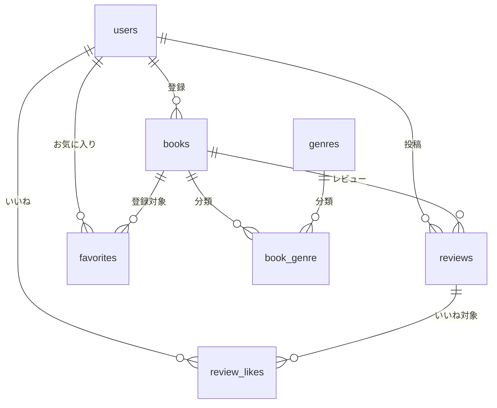

# Bookshelf 書籍レビューアプリ

## 何のアプリか

本を登録し、感想と評価を共有できるWebアプリです。書籍を複数のジャンルで分類し、レビュー、お気に入り、いいね、評価ランキングから読みたい本を探せます。ブラウザ向けのBlade画面と、外部アプリケーション向けの公開JSON APIを備えています。

作成者：[Tomoyuki-Kuge](https://github.com/Tomoyuki-Kuge)

## できること

| 機能 | 利用できること |
|---|---|
| 書籍を読む | ログインせずに一覧・詳細・レビューを閲覧。書籍一覧は10冊ずつ表示 |
| 書籍を登録・管理する | ログインして登録し、複数ジャンルを選択。編集・削除は作成者本人のみ |
| レビューする | ログインして1〜5の評価とコメントを投稿。同じ本への複数投稿ができ、自分のレビューを編集・削除できる |
| いいね・お気に入り | レビューへのいいねと書籍のお気に入りを追加・解除。自分の投稿へのいいねも可能 |
| ジャンルを管理する | ログインして登録・編集・削除。全員共通のジャンルで、書籍が紐付いている間は削除できない |
| ランキングを見る | レビューのある本の評価上位10冊を公開。未丸め平均評価の降順、レビュー件数の降順、書籍IDの昇順で順位を決める |
| 公開APIを使う | 書籍の検索・ジャンル絞り込み・ページ指定・詳細取得・登録・更新・削除 |
| 会員登録・ログイン | 自分のアカウントを作成できるほか、初期データの5人でも動作を確認できる |

範囲の正本は[機能一覧](docs/design/features.md#機能一覧)です。Web一覧の検索・並び順選択、ISBN外部検索、CSV、読書計画・通知などは[今回の対象外](docs/design/features.md#今回作らないもの)です。

## 動かす

GitとDocker Compose v2が使えるDocker環境を用意し、Dockerを起動してください。macOS・Linuxのターミナル、またはWindowsのWSL2上のシェルで実行します。PHP・Composer・Node.jsはコンテナを使います。

| 使用技術 | このリポジトリの構成 |
|---|---|
| PHP / Laravel | PHP 8.5系 / Laravel 10.x |
| 認証・画面 | Laravel Fortify / Blade / セッション認証 |
| DB | MySQL 8.4系、InnoDB、utf8mb4 |
| フロントエンド | Node.js 24系 / Vite / Tailwind CSS 3.4系 / Alpine.js |
| 開発・検証 | Docker Compose / Laravel Sail / phpMyAdmin / PHPUnit / Laravel Pint |

バージョンは[composer.json](composer.json)、[composer.lock](composer.lock)、[package-lock.json](package-lock.json)、[compose.yaml](compose.yaml)に基づきます。PHP 8.5とLaravel 10の組み合わせの対応範囲・検証方針は[設計書の開発環境](docs/design/README.md#開発環境)を参照してください。

1. リポジトリを取得し、開発用の環境設定を用意します。以下の`.env`の準備・編集は、環境を構築する人が行う手順です。

   ```sh
   git clone https://github.com/Tomoyuki-Kuge/bookshelf-app.git
   cd bookshelf-app
   cp .env.example .env
   ```

   `.env.example`の既定値は以下です。`.env`で接続先を確認し、ポートが使用中なら`APP_PORT`・`FORWARD_DB_PORT`を変更してください。`WWWUSER`・`WWWGROUP`は、それぞれ`id -u`・`id -g`で確認したホスト側のIDに合わせます。

   ```dotenv
   APP_URL=http://localhost
   APP_PORT=80
   DB_CONNECTION=mysql
   DB_HOST=mysql
   DB_PORT=3306
   FORWARD_DB_PORT=3307
   DB_DATABASE=bookshelf_app
   DB_USERNAME=sail
   DB_PASSWORD=password
   ```

   アプリからDBへは`mysql:3306`、ホストのDBクライアントからは`127.0.0.1:3307`に接続します。Webポートを変更した場合は`APP_URL`にもそのポートを付けます。`.env`はGitへ追加しません。

2. clone直後は`vendor/`とSailがないため、最初の依存インストールを一時的なComposerコンテナで行います。[このComposerイメージはPHP 8.5ベース](https://github.com/composer/docker/blob/02e6f05ae4effb867a27ea968f667c613f610249/latest/Dockerfile)です。

   ```sh
   docker run --rm \
       -u "$(id -u):$(id -g)" \
       -v "$(pwd):/var/www/html" \
       -w /var/www/html \
       -e COMPOSER_CACHE_DIR=/tmp/composer_cache \
       composer:2.11.3 install --no-scripts --ignore-platform-req='ext-*'
   ```

   この段階だけ拡張機能の要件確認とLaravelのスクリプト実行を省略し、Sailを配置します。PHPのバージョン要件は維持し、手順4でアプリコンテナの依存・拡張機能を確認します。

3. phpMyAdminは`compose.yaml`の`services`直下、`mysql`サービスの後に以下の内容を設定済みです。公開ポートを変更する場合は、`.env`に`FORWARD_PHPMYADMIN_PORT`を指定してください。

   ```yaml
   phpmyadmin:
       image: 'phpmyadmin:latest'
       ports:
           - '${FORWARD_PHPMYADMIN_PORT:-8080}:80'
       environment:
           PMA_HOST: mysql
           PMA_USER: '${DB_USERNAME}'
           PMA_PASSWORD: '${DB_PASSWORD}'
       networks:
           - sail
       depends_on:
           - mysql
   ```

4. アプリイメージを構築し、コンテナを起動します。以降もすべてリポジトリのルートから実行します。`--wait`でMySQLの起動完了を待ち、Sail内で通常の依存インストール・アプリキー生成・初期データ投入を行います。

   ```sh
   ./vendor/bin/sail build laravel.test
   ./vendor/bin/sail up -d --wait
   ./vendor/bin/sail composer install
   ./vendor/bin/sail composer check-platform-reqs --lock
   ./vendor/bin/sail artisan key:generate
   ./vendor/bin/sail artisan migrate --seed
   ./vendor/bin/sail npm ci
   ./vendor/bin/sail npm run build
   ```

   初回は5ユーザー・10ジャンル・11冊・32レビューと、お気に入り・いいねを投入します。内容は[初期データ仕様](docs/design/features.md#初期データ)を参照してください。

5. [アプリ：http://localhost](http://localhost)を開きます。DB管理画面は[http://localhost:8080](http://localhost:8080)です。phpMyAdminは`.env`の`DB_USERNAME`・`DB_PASSWORD`を使ってサーバー`mysql`へ接続します。公開ポートを変更した場合は、アクセス先のURLも合わせてください。

停止は`./vendor/bin/sail stop`、次回起動は`./vendor/bin/sail up -d --wait`です。通常の再起動で初期化やSeeder再実行は不要です。`migrate --seed`を繰り返すとレビューは毎回32件追加されるため、初回投入と区別してください。`migrate:fresh`や`down -v`は既存データを破棄する操作です。

画面のCSS・JavaScriptを開発する場合は、ビルドの代わりに`./vendor/bin/sail npm run dev`を別ターミナルで実行し続けます。ビルド済みアセットを使う場合、Viteの常時起動は不要です。

## ログインする

[ログイン画面](http://localhost/login)で、次のいずれかのメールアドレスと共通パスワード`password`を入力します。[UserSeeder](database/seeders/UserSeeder.php)が作成する初期アカウントで、5人とも一般利用者です。

| 名前 | メールアドレス | 初めに試す用途 |
|---|---|---|
| 山田太郎 | yamada@example.com | 初期11冊の作成者。既存書籍の編集・削除を確認 |
| 鈴木花子 | suzuki@example.com | 別の利用者としてレビューや本人制限を確認 |
| 田中一郎 | tanaka@example.com | レビュー・いいねの相互操作を確認 |
| 佐藤美咲 | sato@example.com | お気に入りや入力エラー時の表示を確認 |
| 高橋健太 | takahashi@example.com | 別の利用者による書籍登録を確認 |

管理者用アカウントはありません。[会員登録](http://localhost/register)から新しい利用者も作成できます。上記の初期アカウントと共通パスワードはローカル確認用です。

## ひととおり触ってみる

1. ログアウト状態で書籍一覧を開き、1ページ目の10冊と次ページの1冊を確認します。本の詳細でジャンル・レビュー・いいね数を見て、ランキングも開きます。
2. 山田太郎でログインします。本を1冊お気に入りに追加し、「お気に入り」で表示を確認します。レビューへいいねを付け、もう一度押して解除します。
3. 「書籍登録」で未使用の半角数字13桁のISBN、タイトル、著者、出版日、1つ以上のジャンルを入力して登録します。説明・画像URLは任意です。登録した本の詳細から編集し、変更が反映されることを確認します。その本もお気に入りに追加します。
4. 同じ本に評価1〜5とコメントを投稿し、自分のレビューを編集します。コメントは必須で1,000文字以内です。投稿したレビューにもいいねを付けます。
5. ログアウトし、鈴木花子で同じ本を開きます。山田太郎の書籍・レビューの編集／削除ボタンが表示されず、自分のレビューは投稿・編集できることを確認します。
6. 「ジャンル管理」で新しいジャンルを作り、名前を編集します。書籍と紐付けたジャンルは削除を拒否され、未使用のジャンルは削除できます。
7. 山田太郎へ戻り、手順3で登録した確認用の本を削除します。お気に入り一覧からその本が消え、ジャンル管理ではジャンル本体が残ることを確認します。書籍と一緒にレビュー・そのいいねも削除されます。

手動の確認項目は[受け入れ条件](docs/design/acceptance.md)、確認済み範囲と残件は[受け入れ報告](docs/acceptance-report.md)を参照してください。幅390pxではランキングの件数と評価の重なり、長いジャンル名で操作列のはみ出しが記録されており、AC-12-04は未達のままです。

## 公開API

ベースURLは`http://localhost/api/v1`です。読み取り・書き込みの5経路とも認証・トークンは不要です。Web画面の本人制限はAPIには適用されません。

| メソッド | パス | 概要・成功時の応答 |
|---|---|---|
| GET | /api/v1/books | 一覧・キーワード検索・ジャンル絞り込み・ページ指定。200 |
| GET | /api/v1/books/{book} | 書籍・ジャンル・全レビュー・集計値の詳細。200 |
| POST | /api/v1/books | 書籍を登録し、保存後の詳細を返す。201 |
| PUT | /api/v1/books/{book} | 書籍とジャンル集合を更新し、詳細を返す。200 |
| DELETE | /api/v1/books/{book} | 書籍と関連データを物理削除。204、本文なし |

一覧は`keyword`（タイトル・著者の部分一致）、`genre_id`、`page`、`per_page`（1〜100、既定20）を指定できます。取得例：

```sh
curl --get 'http://localhost/api/v1/books' \
    -H 'Accept: application/json' \
    --data-urlencode 'keyword=コード' \
    --data-urlencode 'per_page=5'
```

POST・PUTは`Accept: application/json`と`Content-Type: application/json`を付け、JSON本文に`user_id`・`title`・`author`・`isbn`・`published_date`・`genres`を指定します。`user_id`と`genres`の要素は実在するIDのJSON整数、出版日は`YYYY-MM-DD`です。PUTも必須項目を省略できず、指定した`user_id`へ書籍の作成者を変更できます。

削除以外の成功データは`data`に入り、一覧には`links`・`meta`が付きます。入力不正は422、存在しない書籍は404です。完全な入力・JSON構造・エラー形式は[公開API仕様](docs/design/permissions-api.md#公開api)を参照してください。

## テストと整形

初回セットアップが済んだコンテナで、リポジトリのルートから実行します。テストは[.env.testing](.env.testing)と[phpunit.xml](phpunit.xml)を使い、MySQL 8.4の専用DB`testing`を対象にします。MySQLの初回起動時に作成されます。既存ボリュームにない場合は、管理者が既存データを保持したまま`testing`を作成し、テスト用ユーザーの権限を設定してください。

```sh
./vendor/bin/sail composer test
```

[composer.json](composer.json)のtestスクリプトがテスト設定のキャッシュをクリアしてから全テストを実行します。接続情報を変更した環境では、実行時の環境変数でテスト用DBの接続情報を合わせてください。開発用の`bookshelf_app`をテスト対象にしません。

PHPの整形は変更したファイルを指定します。以下のパスは整形対象に置き換えてください。

```sh
./vendor/bin/sail pint app/Http/Requests/BookRequest.php
./vendor/bin/sail pint --test app/Http/Requests/BookRequest.php
git diff --check
```

pcovが有効な環境では、カバレッジも確認できます。基本要件の目標は60%超です。

```sh
./vendor/bin/sail php -d pcov.enabled=1 -d pcov.directory=/var/www/html/app \
    artisan test --env=testing --coverage --min=60
```

既存の実行結果は[受け入れ報告](docs/acceptance-report.md)に記録しています。最新の全テストは368件・9,782アサーション成功、カバレッジ97.9%は先行する362件実行時の値です。

AIエージェントは[AGENTS.md](AGENTS.md)に従い、`.env`を直接・間接に読み書きしません。Sailも`.env`を読むため、起動済みコンテナでの検証には次のCompose直接実行を使います。Laravelとテスト子プロセスは`.env.testing`を選びます。

```sh
docker compose --env-file .env.example -f compose.yaml exec -T \
    -e APP_ENV=testing laravel.test composer test
docker compose --env-file .env.example -f compose.yaml exec -T \
    laravel.test vendor/bin/pint --test app/Http/Requests/BookRequest.php
```

## 中身の地図

| 場所 | 役割 |
|---|---|
| routes/web.php / routes/api.php | Web画面と公開APIの経路 |
| app/Http/Controllers/ | Webの処理。Api/配下に公開書籍API |
| app/Http/Requests/ / app/Http/Resources/ | 入力検証とAPIのJSON出力 |
| app/Models/ / app/Policies/ | データの関連と書籍・レビューの本人制限 |
| resources/views/ | 完成済みBlade画面・共通部品 |
| database/migrations/ / database/seeders/ | テーブル定義と責務別の初期データ |
| tests/Feature/ / tests/Unit/ | 機能・認証・API・関連・競合・初期データ等のテスト |
| [docs/design/](docs/design/README.md) | 機能・画面・API・DB・処理・確認事項・AC・テスト観点の正本 |
| [docs/acceptance-report.md](docs/acceptance-report.md) / [uat-shots/](uat-shots/) | 受け入れ状態と、各検証回の報告・画面証拠 |
| [compose.yaml](compose.yaml) / [.env.example](.env.example) | コンテナ構成と共有する設定例 |

業務データのER図です。`book_genre`・`favorites`・`review_likes`は専用IDと組の一意制約を持つ中間表です。列・型・削除制約の詳細は[データ設計](docs/design/data.md)を参照してください。


