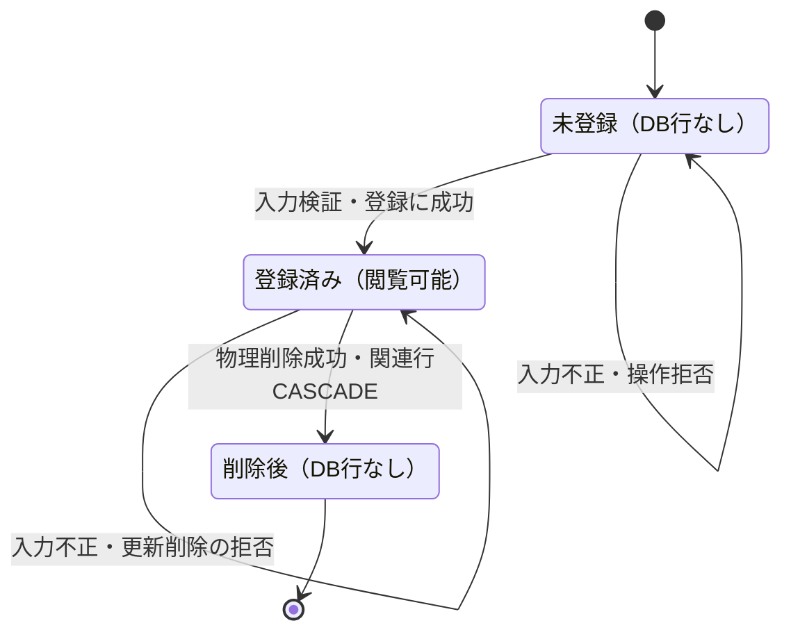
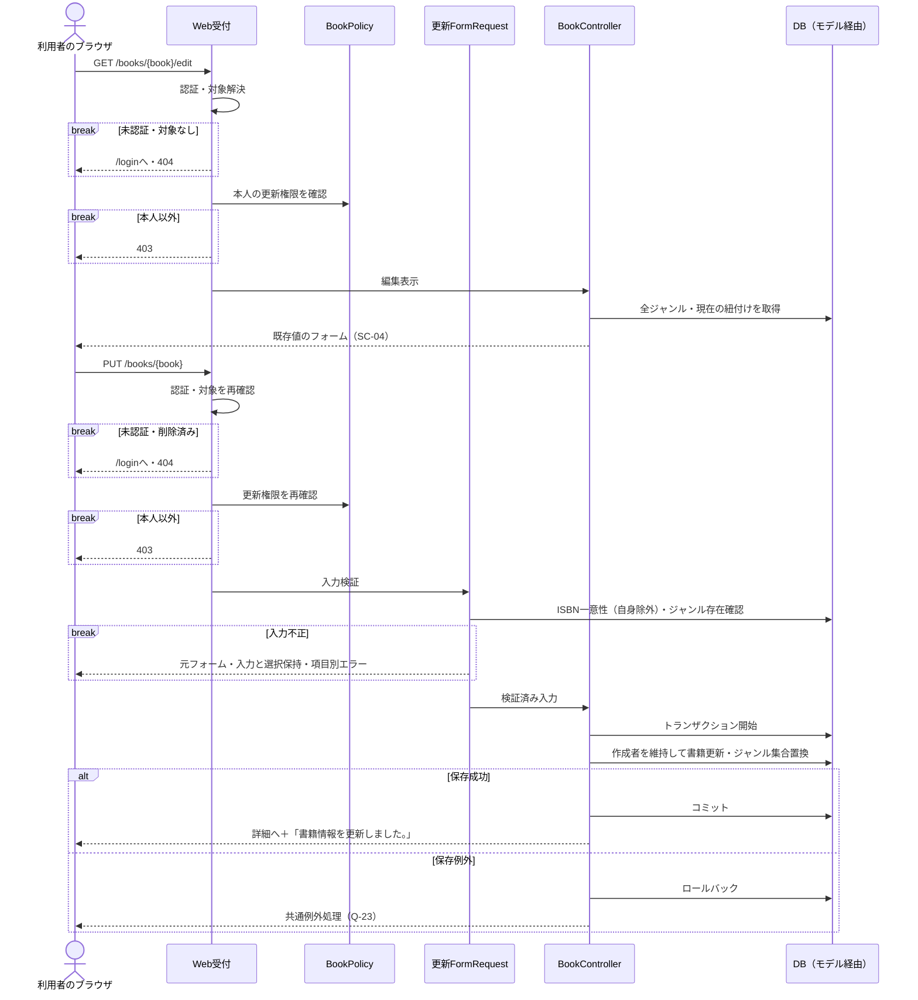

# 状態遷移・シーケンス・例外方針

作成日: 2026-11-15 / 最終整理日: 2026-11-25

共通方針は [README.md](README.md)。状態図は書籍データ、シーケンスはWeb書籍編集（F-07・09）の代表1本とする。確定条件はQ-01〜05・07・10・12・18・20〜25、S7・8・12に従う。2026-11-22確認のQAでQ-23の保存・競合・障害方針を承認済み。未指定の個別エラー文言はQ-19の残件に従う。経路はpermissions-api.md、表示文言はscreens.md、物理制約・削除範囲はdata.mdを参照する。

## 書籍データの状態遷移

存在の状態でありstatus列は追加しない。未登録・削除後はDB行なし、登録済みは公開。編集画面を開いてもDB状態は変わらず、下書き・承認・非公開・復元は設けない。

Web登録は認証・入力検証、編集・削除は加えて作成者本人。Webの作成者は変更しない。基本APIは認証不要でPOST・PUTに実在user_id必須、Q-18に従い実在する指定user_idへの登録者変更を許可し、変更後のWeb権限は新登録者で判定する。登録201・更新200・削除204。削除後の参照・更新・再削除は404、再登録は別レコードとする。

編集でレビュー等は削除しない。書籍・レビューの削除範囲とCASCADE・RESTRICTの注意点は [data.md](data.md#外部キーと親削除時の動作) に集約する。保存途中の失敗はQ-23に従い当該操作の変更を全体として取り消す。

## 代表シーケンス：書籍の編集

GET・PUTごとに認証→対象解決→BookPolicyで判定し、GETの許可をPUTへ引き継がない。図の受付・責務は説明用で、専用クラス追加の指定ではない。書籍本体とジャンル集合を1トランザクションで保存し、部分更新を防ぐ（Q-23承認済み）。

- 成功後はGET詳細で更新済み書籍・ジャンル・レビュー等を取得する。
- 全ジャンル解除後の入力不正でも未選択を保持し、既存選択を復活させない。実現方法は [screens.md](screens.md#実装時に照合すること) を参照。
- 図はCSRF検証通過後を前提とする。セッション失効でも常にログインへ到達する保証はなく、CSRF失効は419の既定画面を表示し、入力を保持せず再表示・再入力とする（認証失効時は再ログイン）。
- API更新に本人Policyは適用せず、JSONで返す。MVCに従うためクラス図・追加のシーケンス図は作らない。

## 例外方針

### 確定している結果

| 条件 | Web | 基本API |
|---|---|---|
| 未認証 | 保護経路は /loginへ | 認証不要 |
| 他人の編集・更新・削除 | 書籍・レビューは403、画面の本人操作も非表示 | 書籍の所有者制限なし |
| 対象なし・削除済み | 404 | 書籍詳細・更新・削除は404＋error「書籍が見つかりませんでした。」 |
| 入力不正 | 元フォームへ、パスワード以外・ジャンル選択保持、欄下に日本語エラー。保存しない | 422＋message・項目別errors。保存しない |
| 紐付きジャンル削除 | 一覧へ戻り確定した削除不可文言。事前確認後の競合もRESTRICTで同じ結果 | 対応APIなし |
| いいね・お気に入り | 操作元へ、状態・件数を再表示、フラッシュなし | 対応APIなし |

ログイン認証失敗は「ログイン情報が登録されていません」をemail欄下へ表示する（Q-19承認済み）。成功・失敗文言は [screens.md](screens.md#操作結果とエラーの扱い)、API形式は [permissions-api.md](permissions-api.md#エラーの返し方) に従う。すべてのDB例外を422へ変換しない。

### 保存・競合・障害応答

Seederは2026-11-21ユーザー承認により、全体・個別実行とも途中保存を残さず例外をCLIへ返す。保存単位と依存検査は[初期データ設計](features.md#再実行と未確定事項)を参照する。Web／APIの結果は2026-11-22確認のQAにより次の方針を承認済み。

- 書籍項目とジャンル集合は1トランザクションで保存し、途中失敗は当該操作全体を取り消す。検証後のISBN重複は原因を特定できる一意制約違反だけを通常の重複エラーへ変換し、Webは入力保持・APIは422とする。選択ジャンルやAPI参照ユーザーの消失も取り消して該当入力エラーへ戻す。ジャンルの未指定文言はQ-19の確定後に揃える。
- 同時編集は楽観的ロックを導入せず後から正常に保存された内容を採用する。項目ごとの自動マージやversion列・409応答は加えず、編集中に書籍が消えた場合は404で再作成しない。
- いいね・お気に入りは同一利用者・対象の操作を直列化し、受け付けた操作ごとにトグルする。一意制約を維持し、通信失敗時に自動再送しない。
- 認証・CSRF・経路・JSON構文の確認を通過した処理では、対象なし404を入力不正422より優先する。不正JSONは400「JSONの形式が正しくありません。」、非対応メソッドは405「この操作方法には対応していません。」をAPIのmessage付きJSONで返す。WebのCSRF失効は419の既定画面を使い、入力を保持せず再表示・再入力とする。
- 想定外障害はWebの既定500画面、APIは500＋message「処理に失敗しました。時間をおいて再度お試しください。」。SQL・スタックトレース・認証情報を応答に含めず、すべてのDB障害を422へ変換しない。
- ログはアプリのログ領域へ日次出力・14日保持とし、日時・経路・例外種別を記録する。パスワード・トークン・リクエスト全文を記録しない。具体的な保存先・期間の設定と運用条件との照合、排他・例外処理の方式は、該当実装時に開発側で確認する。

回答根拠と残件は [Q-23](questions.md#q-23保存失敗同時操作障害時の扱い) を参照する。これらは設計上の確定方針であり、後続のWeb／API実装・検証を完了したことを示さない。

お気に入り解除後は現ページを維持し、消滅した場合だけ最後の有効ページへ戻す。全件0件なら1ページ目の既定の0件表示とする（Q-24）。詳細からの操作は詳細へ戻す。APIの範囲外ページはQ-22に従い200＋空配列とし、Webの補正と区別する。

### Issue #5のジャンル保存・削除の補足（2026-11-25ユーザー承認）

- 検証後のジャンル名重複は、MySQLの重複コードとgenresのname関連の一意索引を特定できる場合だけ、通常のname重複エラーへ戻す。登録・編集フォームへ文字列入力を保持し、Q-19の暫定重複文言を使う。別のDB障害は入力エラーへ変換しない。
- ジャンル削除はbooks関連の存在を事前確認し、確認後に追加された紐付けもbook_genreのgenre_idに対するRESTRICT違反を特定して、同じ削除不可文言で一覧へ戻す。書籍・中間行を先に消す処理は行わない。
- 更新時は対象行を保存直前にも確認し、削除済みなら404として再作成しない。既存の後勝ち方針を維持し、版管理や自動再送は追加しない。
- 想定外障害は既定の500応答とし、入力エラーや削除不可へ一律変換しない。検証はtesting DBで行い、競合の模擬挿入と独立接続による実際の並行実行を区別して報告する。
