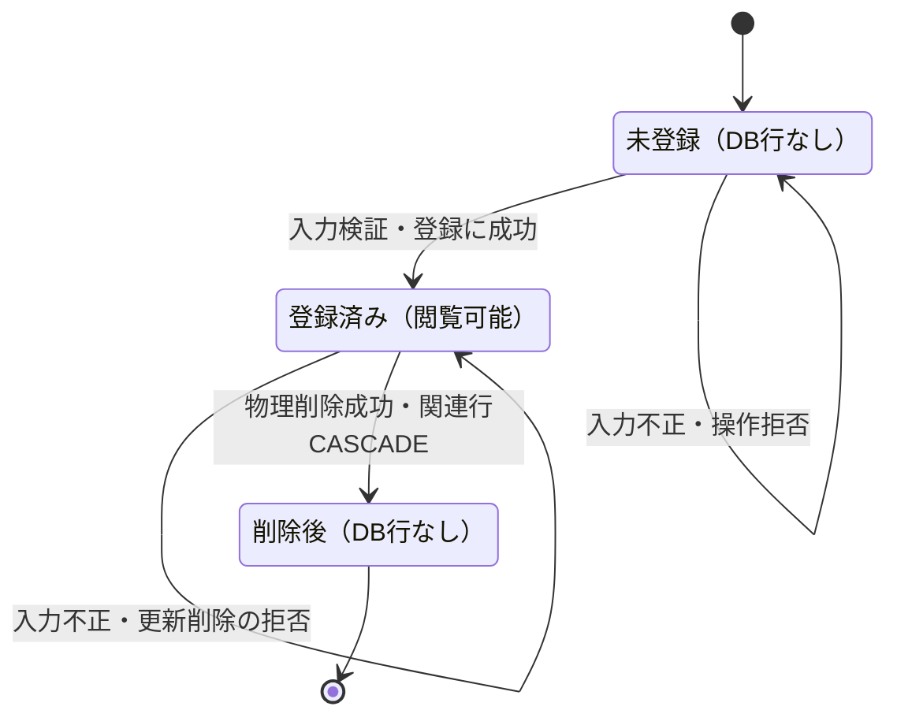
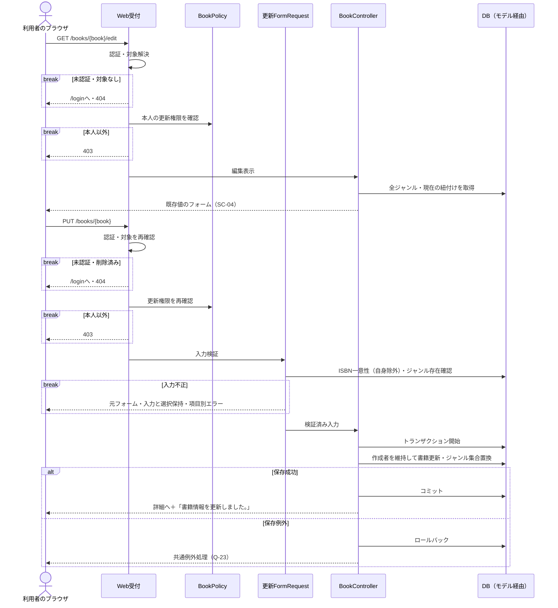

# 状態遷移・シーケンス・例外方針

作成日: 2026-11-15 / 最終整理日: 2026-11-26

共通方針は [README.md](README.md)。状態図は書籍データ、シーケンスはWeb書籍編集（F-07・09）の代表1本とする。確定条件はQ-01〜05・07・10・12・18・20〜25、S7・8・12に従う。2026-11-22確認のQAでQ-23の保存・競合・障害方針を承認済み。未指定の個別エラー文言はQ-19の残件に従う。経路はpermissions-api.md、表示文言はscreens.md、物理制約・削除範囲はdata.mdを参照する。

## 認証・閲覧の処理

### 認証処理（Issue #2）

2026-11-20ユーザー承認。当時のLaravel 10・PHP 8.2を前提にFortify候補v1.30.0の依存条件を確認し、導入時の依存解決結果をcomposer.lockへ固定する方針とした。現在の開発環境は[README.md](README.md#開発環境)に従う。

[認証5経路](permissions-api.md#webルーティング一覧)をFortifyのControllerへ接続する。登録はFormRequestとCreatesNewUsersの登録Action、ログインはFortifyのLoginRequestを拡張したFormRequestで入力条件・日本語messages()を定義する。認証・セッション管理を独自実装で並立させない。ログアウトはセッション破棄・CSRFトークン再生成を行う。試行制限と遷移は[screens.md](screens.md#認証の接続補足issue-2)を参照する。

### 公開閲覧の取得（Issue #4）

2026-11-23ユーザー承認。既存のEloquent関連・集計・ページ分割を使い、一覧の現行取得処理を再利用する。詳細は対象書籍のgenres、登録日時降順のreviewsと各user・likedByUsersを一括取得する。認証済みでは利用者のfavoriteBooks・likedReviewsも取得し、既存Bladeの状態表示へ渡す。件数専用属性だけを追加して既存Bladeの関連参照を置き換えない。経路・対象解決は[Issue #4の接続](permissions-api.md#issue-4の公開閲覧接続2026-11-23ユーザー承認)、出版日は[SC-03と画面差分](screens.md#sc-03-書籍登録sc-04と共通)に従う。

### ジャンルの取得（Issue #5）

2026-11-25ユーザー承認。一覧はwithCount('books')でID昇順に全件取得する。詳細は対象のbooks関連に条件を掛けてから登録日時降順・10件でページ分割し、各書籍のgenresを一括取得する。経路・対象解決は[Issue #5の接続](permissions-api.md#issue-5のジャンル管理接続2026-11-25ユーザー承認)に従う。

## 書籍データの状態遷移

存在の状態でありstatus列は追加しない。未登録・削除後はDB行なし、登録済みは公開。編集画面を開いてもDB状態は変わらず、下書き・承認・非公開・復元は設けない。

WebとAPIの認可・登録者の扱いは[権限マトリクス](permissions-api.md#権限マトリクス)と[API入力定義](permissions-api.md#入力定義)に従う。削除後の参照・更新・再削除は404、再登録は別レコードとする。

編集でレビュー等は削除しない。書籍・レビューの削除範囲とCASCADE・RESTRICTの注意点は [data.md](data.md#外部キーと親削除時の動作) に集約する。保存途中の失敗はQ-23に従い当該操作の変更を全体として取り消す。

## 代表シーケンス：書籍の編集

GET・PUTごとに認証→対象解決→BookPolicyで判定し、GETの許可をPUTへ引き継がない。図の受付・責務は説明用で、専用クラス追加の指定ではない。書籍本体とジャンル集合を1トランザクションで保存し、部分更新を防ぐ（Q-23承認済み）。

- 成功後はGET詳細で更新済み書籍・ジャンル・レビュー等を取得する。
- 全ジャンル解除後の入力不正でも未選択を保持し、既存選択を復活させない。実現方法は [screens.md](screens.md#実装時に照合すること) を参照。
- 図はCSRF検証通過後を前提とする。セッション失効でも常にログインへ到達する保証はなく、CSRF失効は419の既定画面を表示し、入力を保持せず再表示・再入力とする（認証失効時は再ログイン）。
- API更新に本人Policyは適用せず、JSONで返す。MVCに従うためクラス図・追加のシーケンス図は作らない。

## 例外方針

### 確定している結果

| 条件 | Web | 基本API |
|---|---|---|
| 未認証 | 保護経路は /loginへ | 認証不要 |
| 他人の編集・更新・削除 | 書籍・レビューは403、画面の本人操作も非表示 | 書籍の所有者制限なし |
| 対象なし・削除済み | 404 | 書籍詳細・更新・削除は404、本文は[APIエラー契約](permissions-api.md#エラーの返し方) |
| 入力不正 | 元フォームへ、パスワード以外・ジャンル選択保持、欄下に日本語エラー。保存しない | 422＋message・項目別errors。保存しない |
| 紐付きジャンル削除 | 一覧へ戻り確定した削除不可文言。事前確認後の競合もRESTRICTで同じ結果 | 対応APIなし |
| いいね・お気に入り | 操作元へ、状態・件数を再表示、フラッシュなし | 対応APIなし |

ログイン認証失敗の表示は[screens.mdの入力チェック](screens.md#入力チェックとエラーメッセージ)に従う（Q-19承認済み）。成功・失敗文言は [screens.md](screens.md#操作結果とエラーの扱い)、API形式は [permissions-api.md](permissions-api.md#エラーの返し方) に従う。すべてのDB例外を422へ変換しない。

### 保存・競合・障害応答

Seederは2026-11-21ユーザー承認により、全体・個別実行とも途中保存を残さず例外をCLIへ返す。保存単位と依存検査は[初期データ設計](features.md#再実行と未確定事項)を参照する。Web／APIの結果は2026-11-22確認のQAにより次の方針を承認済み。

- 書籍項目とジャンル集合は1トランザクションで保存し、途中失敗は当該操作全体を取り消す。検証後のISBN重複は原因を特定できる一意制約違反だけを通常の重複エラーへ変換し、Webは入力保持・APIは422とする。選択ジャンルやAPI参照ユーザーの消失も取り消して該当入力エラーへ戻す。Webは元フォームへ入力を保持し、ジャンル欄下に表示する。文言と暫定採用の状態は[Q-19](questions.md#q-19画面のエラー文言表示先)、APIのキー・文言は[エラー契約](permissions-api.md#エラーの返し方)に従う。
- 同時編集は楽観的ロックを導入せず後から正常に保存された内容を採用する。項目ごとの自動マージやversion列・409応答は加えず、編集中に書籍が消えた場合は404で再作成しない。
- いいね・お気に入りは同一利用者・対象の操作を直列化し、受け付けた操作ごとにトグルする。一意制約を維持し、通信失敗時に自動再送しない。
- 認証・CSRF・経路・JSON構文の確認を通過した処理では、対象なし404を入力不正422より優先する。不正JSONは400、非対応メソッドは405とし、本文は[APIエラー契約](permissions-api.md#エラーの返し方)に従う。Webのメソッドエラー・CSRF失効は既定エラー画面を使い、独自画面は追加しない。CSRF失効は419で入力を保持せず再表示・再入力（認証失効時は再ログイン）とする。
- 想定外障害はWebの既定500画面、APIは[APIエラー契約](permissions-api.md#エラーの返し方)の500。SQL・スタックトレース・認証情報を応答に含めず、すべてのDB障害を422へ変換しない。
- ログはアプリのログ領域へ日次出力・14日保持とし、日時・経路・例外種別を記録する。パスワード・トークン・リクエスト全文を記録しない。具体的な保存先・期間の設定と運用条件との照合、排他・例外処理の方式は、該当実装時に開発側で確認する。

回答根拠と残件は [Q-23](questions.md#q-23保存失敗同時操作障害時の扱い) を参照する。これらは設計上の確定方針であり、後続のWeb／API実装・検証を完了したことを示さない。

お気に入り解除後は現ページを維持し、消滅した場合だけ最後の有効ページへ戻す。全件0件なら1ページ目の既定の0件表示とする（Q-24）。詳細からの操作は詳細へ戻す。APIの範囲外ページはQ-22に従い200＋空配列とし、Webの補正と区別する。

### Issue #5のジャンル保存・削除の補足（2026-11-25ユーザー承認）

- 検証後のジャンル名重複は、MySQLの重複コードとgenresのname関連の一意索引を特定できる場合だけ、通常のname重複エラーへ戻す。登録・編集フォームへ文字列入力を保持し、Q-19の暫定重複文言を使う。別のDB障害は入力エラーへ変換しない。
- ジャンル削除はbooks関連の存在を事前確認し、確認後に追加された紐付けもbook_genreのgenre_idに対するRESTRICT違反を特定して、同じ削除不可文言で一覧へ戻す。書籍・中間行を先に消す処理は行わない。
- 更新時は対象行を保存直前にも確認し、削除済みなら404として再作成しない。既存の後勝ち方針を維持し、版管理や自動再送は追加しない。
- 想定外障害は既定の500応答とし、入力エラーや削除不可へ一律変換しない。検証はtesting DBで行い、競合の模擬挿入と独立接続による実際の並行実行を区別して報告する。

### Issue #6の書籍保存・障害処理の補足（2026-11-25ユーザー承認）

- 各入口で認証→対象解決→BookPolicyの本人認可→入力検証を行う。更新・削除のトランザクション内でも対象行をlockForUpdateで再取得し、存在と本人権限を再確認する。対象消失は404とし、再生成しない。後勝ち・項目とジャンル集合の一括保存を維持する。
- 書籍項目とgenres()->sync()を1トランザクションで保存する。Web作成者は認証情報から設定し、更新では維持する。任意項目の空欄NULLと出版日文字列はQ-22・25に従う。出版日は有効日付を検証してDATE保存用のYYYY-MM-DDへ揃え、入力に出力形式だけを理由とした追加制限を設けない。
- 検証後のISBN重複はbooksのISBN一意索引に対する既知の重複違反だけを入力エラーへ変換する。選択ジャンルは保存前に共有ロックで取得して存在を再確認し、保存完了まで参照先を維持する。消失は該当外部キー違反または保存時の存在再確認で特定し、全体取消後に元フォームへ旧入力とジャンルエラーを戻す。他のDB障害は通常の例外処理へ渡す。
- 入力エラーの戻り先は登録または対象書籍編集の内部ルートとする。全解除時のgenresは空配列を旧入力へ保存し、不正な配列等をテキスト欄へ戻さない。Q-19の暫定文言と正式文言確認待ちを区別する。
- 今回の障害処理に必要な範囲で既存Handlerとlogging設定を補足し、日次・14日保持、日時・経路・例外種別の記録、機密情報・リクエスト全文の非記録を検証する。通常のWeb障害はデバッグ設定の有効・無効によらず既定500画面とし、SQL・スタックトレース・認証情報を応答へ含めない。想定内の認証・入力・認可・対象不存在・CSRF等の応答は維持し、500へ一律変換しない。保護対象.envは確認せず、実環境の設定上書き状況は未確認として報告する。
- 競合検証は模擬状態変更と実並行実行を分ける。実並行検証はtesting DBの独立接続・プロセスと同期を使い、固定sleepだけで順序を仮定せず、タイムアウトと失敗時の後片付けを設ける。

### Issue #7のレビュー保存・削除の補足（2026-11-26ユーザー承認）

- 投稿は認証→経路の書籍確認→入力検証、編集・更新・削除は認証→レビュー確認→ReviewPolicyの本人認可→入力検証とする。投稿者は認証情報、投稿先は経路から決め、更新でも両方を維持する。送信されたuser_id・book_idは採用しない。
- 投稿・更新・削除はトランザクション内で親書籍を共有ロックして存在を再確認する。更新・削除はその後にレビューをlockForUpdateで再取得し、存在・本人権限を再確認する。親→子の順で取得して書籍削除と順序を揃える。親または対象レビューが既に削除されていれば404で再作成せず、当該操作は保存しない。
- 同時更新は後から正常保存した評価・コメントを採用する。楽観的ロック・version列・409・項目別自動マージ・自動再送は追加しない。書籍削除が先に完了した場合は404、レビュー保存が先に共有ロックを取得した場合は書籍削除を保存完了まで待機させる。完了後の別操作による書籍削除まで禁止するものではない。
- 入力エラーは投稿ならbooks.show、更新ならreviews.editの内部ルートへ戻し、Q-19の暫定文言を欄下へ表示して型安全な旧入力を保持する。編集初期値へ戻して入力不正後の未選択・空欄を消さない。
- 削除は対象レビューとそのいいねの既存CASCADEだけを利用する。保存途中の失敗はトランザクションで当該操作全体を取り消し、成功フラッシュを返さない。想定外DB障害を入力エラーへ一律変換せず、既存の機密を含まない共通障害応答・ログへ渡す。
- 競合は模擬状態変更と実並行検証を分け、独立接続・プロセスと同期で後勝ち、レビュー削除後・親書籍削除後404、共有ロック中の書籍削除待機を確認する。testing DB限定、タイムアウト・後片付けを設ける。

### Issue #8のレビューいいね保存・競合処理の補足（2026-11-26設計補足）

Q-23の確定方針を実現する排他方式を次のとおり補足する。実装・検証の完了を示すものではない。

- 追加・解除は1トランザクションで行う。経路のレビューが属する親書籍を共有ロックで再取得し、その後に対象レビューをlockForUpdateで再取得する。既存のレビュー更新・削除と同じ親→子の順序とし、親またはレビューが消失していれば404で終了して再作成しない。
- 認証情報・経路の解決後、本経路の新しいトランザクションで親書籍とレビューをロックする。レビューのロック取得後に、認証利用者と対象レビューの組の登録状態を、トランザクション内で最初の非ロックSELECTとしてDBから取得する。REPEATABLE READの読み取りスナップショットをロック待機後に確立し、先行操作の確定結果を反映する。これより前に同トランザクション内で非ロックSELECTを行わず、事前ロード済みの関連や既存の読み取りスナップショットを切り替え判断に使わない。
- いいね中間行の検索にはFOR UPDATEを付けない。未登録の組の検索でギャップロックを取得し、別レビューへの同時追加と相互待機することを避ける。同一レビューの切り替え判断と保存の排他はレビュー行のロックで保証する。未登録なら追加、登録済みならその組だけを解除し、既存のUNIQUE(user_id, review_id)と中間行の日時管理を維持する。レビュー本体・他利用者のいいね・別レビューの関連行を変更しない。
- レビュー行の排他ロックによって同一利用者・対象の操作を直列化し、受け付けた操作ごとに切り替える。この方式では同じレビューへの別利用者の操作も待機する。別レビューにはそれぞれのレビュー行のロックを使う。組ごとの専用ロックや保存テーブルは追加しない。
- 削除が先に完了した場合は404とする。いいね操作が先に必要なロックを取得した場合は書籍・対象レビューの削除を保存完了まで待機させ、後から削除された際のいいね除去は既存CASCADEに任せる。いいね操作の完了後の削除まで禁止しない。
- 保存途中の失敗は当該操作全体を取り消す。想定外DB障害は既存の共通障害応答・機密を含まないログ処理へ渡し、入力エラーや成功へ変換しない。通信失敗時の自動再送は追加しない。成功時の遷移・表示はscreens.mdとpermissions-api.mdに従う。

### Issue #9のお気に入り保存・戻り先の補足（2026-11-26ユーザー依頼による設計補足）

Q-23・24の確定方針と実装計画のレビューを踏まえ、次の方式を補足する。今回の承認対象は設計補足であり、実装着手・検証完了を示さない。

- 利用者は認証情報、対象書籍は経路から決め、送信されたuser_id・book_idは採用しない。書籍所有者の本人制限は適用せず、認証利用者と対象書籍の組だけを追加・解除する。一覧は既存のfavoriteBooks関連から自分の登録分を取得し、favorites.created_atの降順・10件／ページで既存Bladeへ渡す。DB定義・依存パッケージ・完成済みBladeは変更しない。
- 追加・解除は本経路の新しい1トランザクションで行い、対象書籍をlockForUpdateで再取得する。書籍のロック取得後、トランザクション内で最初の非ロックSELECTとして対象の組の登録状態をDBから取得する。それ以前に非ロックSELECTを行わず、事前ロード済みの関連や古い読み取りスナップショットを判断に使わない。ロック待機後に先行操作の確定結果を読み、受付ごとに切り替える。
- favoritesの登録状態を検索するSELECTにはFOR UPDATEを付けず、未登録範囲のギャップロックを避ける。未登録なら既存の日時管理付き関連で追加し、登録済みならその組だけを解除する。UNIQUE(user_id, book_id)を維持し、書籍本体・他利用者のお気に入り・他の関連行は変更しない。
- 書籍行の排他ロックで同一利用者・対象の操作を直列化するため、同じ書籍への別利用者のお気に入り操作と、同じ書籍の共有ロックを使うレビュー・いいね操作も待機する。別書籍には各書籍行のロックを使う。専用ロックテーブルや自動再送は追加しない。
- 書籍削除が先に完了した場合は再取得時に404とし、再作成しない。お気に入り操作が先にロックした場合は書籍削除を保存完了まで待機させ、その後の関連削除は既存CASCADEに任せる。保存途中の障害は当該操作全体を取り消し、既存の共通障害応答・機密を含まないログ処理へ渡す。
- 既存Bladeには操作元・ページの送信項目がないため、Refererを操作元判定の補助として使う。同一オリジン（スキーム・ホスト・実効ポートが一致）で、パスがfavorites.indexの生成するパスと一致する場合だけ一覧からの操作と判定する。Referer自体へリダイレクトせず、名前付き内部ルートから戻り先を生成する。Referer欠落・解析不能・外部オリジン・その他のパスの場合は、経路の対象書籍のbooks.showへ戻す。操作元情報を認証・対象書籍・保存対象の決定には使わない。
- 一覧からの操作ではRefererのpageだけを参照し、省略時は1とする。単一の正の整数として安全に扱えない値（配列・0・負数・非整数・整数範囲超過等）は1として扱い、他のクエリやフラグメントは引き継がない。保存のコミット後に自分のお気に入り総件数を取得し、要求ページと最終有効ページの小さい方へ戻す。全件0件の最終有効ページは1とする。保存前の件数や書籍一覧の件数を補正に使わず、成功フラッシュは出さない。
