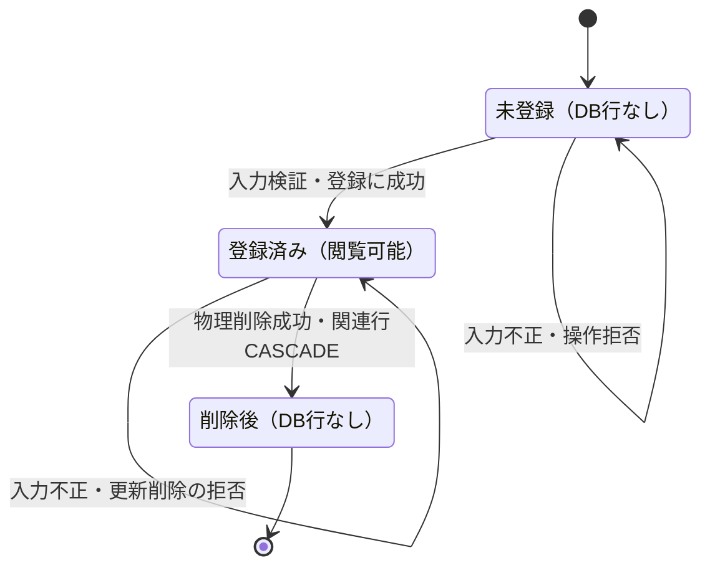

# 状態遷移・シーケンス・例外方針

作成日: 2026-11-15 / 最終整理日: 2026-11-20

共通方針は [README.md](README.md)。状態図は書籍データ、シーケンスはWeb書籍編集（F-07・09）の代表1本とする。確定条件はQ-01〜05・07・10・12・20〜21、S7・8・12に従い、未指定の保存方式・障害応答は**Q-23の未承認案**。経路はpermissions-api.md、表示文言はscreens.md、物理制約・削除範囲はdata.mdを参照する。

## 書籍データの状態遷移

存在の状態でありstatus列は追加しない。未登録・削除後はDB行なし、登録済みは公開。編集画面を開いてもDB状態は変わらず、下書き・承認・非公開・復元は設けない。

Web登録は認証・入力検証、編集・削除は加えて作成者本人。Webの作成者は変更しない。基本APIは認証不要でPOST・PUTに実在user_id必須、変更可否はQ-18保留。登録201・更新200・削除204。削除後の参照・更新・再削除は404、再登録は別レコードとする。

編集でレビュー等は削除しない。書籍・レビューの削除範囲とCASCADE・RESTRICTの注意点は [data.md](data.md#外部キーと親削除時の動作) に集約する。保存途中の失敗はQ-23の原子保存案なら操作前へ戻す。

## 代表シーケンス：書籍の編集

GET・PUTごとに認証→対象解決→BookPolicyで判定し、GETの許可をPUTへ引き継がない。図の受付・責務は説明用で、専用クラス追加の指定ではない。書籍本体とジャンル集合を1トランザクションで保存し、部分更新を防ぐ想定だが、Q-23の採否は未確定。

- 成功後はGET詳細で更新済み書籍・ジャンル・レビュー等を取得する。
- 全ジャンル解除後の入力不正でも未選択を保持し、既存選択を復活させない。実現方法は [screens.md](screens.md#実装時に照合すること) を参照。
- 図はCSRF検証通過後を前提とする。セッション失効でも常にログインへ到達する保証はなく、CSRF失効はQ-23で別途決める。
- API更新に本人Policyは適用せず、JSONで返す。MVCに従うためクラス図・追加のシーケンス図は作らない。

## 例外方針

### 確定している結果

| 条件 | Web | 基本API |
|---|---|---|
| 未認証 | 保護経路は /loginへ | 認証不要 |
| 他人の編集・更新・削除 | 書籍・レビューは403、画面の本人操作も非表示 | 書籍の所有者制限なし |
| 対象なし・削除済み | 404 | 書籍詳細・更新・削除は404＋message |
| 入力不正 | 元フォームへ、パスワード以外・ジャンル選択保持、欄下に日本語エラー。保存しない | 422＋message・項目別errors。保存しない |
| 紐付きジャンル削除 | 一覧へ戻り確定した削除不可文言。事前確認後の競合もRESTRICTで同じ結果 | 対応APIなし |
| いいね・お気に入り | 操作元へ、状態・件数を再表示、フラッシュなし | 対応APIなし |

ログイン認証失敗の文言は確定、対応項目はQ-19の認証部分の暫定採用に従う（クライアント確認待ち）。成功・失敗文言は [screens.md](screens.md#操作結果とエラーの扱い)、API形式は [permissions-api.md](permissions-api.md#エラーの返し方) に従う。すべてのDB例外を422へ変換しない。

### 未確定の保存・競合・障害応答

具体的な想定と「その想定でよいか」の確認は [Q-23](questions.md#q-23保存失敗同時操作障害時の扱い) に集約する。図の原子保存、ISBN競合の通常エラー化、参照ID消失、同時編集、トグル連打、404優先、400・405・419・500の応答、ログ保存を含めて**未承認**。利用者・API利用者に見える結果はクライアント、内部方式は開発側で検討し、運用条件は必要に応じて確認する。

お気に入り解除後に現在のページがなくなる場合は [Q-24](questions.md#q-24お気に入り解除後のページ補正) の未承認案を参照。Q-01の操作元へのリダイレクトだけでページ補正方法まで確定しない。APIのnull・日時例もdata.mdの未確定物理条件を確定する根拠にしない。
