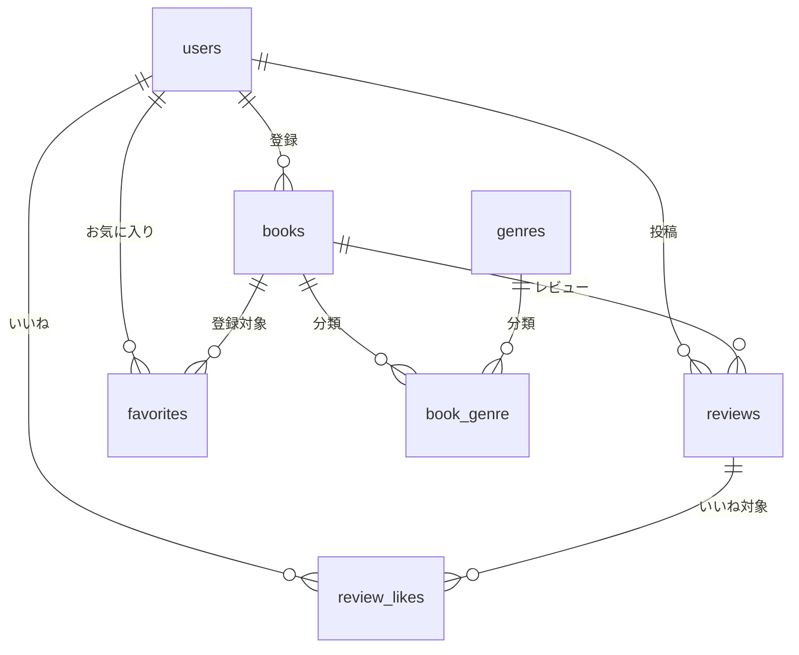

# データ設計

作成日: 2026-11-14 / S12反映日: 2026-11-15 / 最終整理日: 2026-11-19

## 範囲・根拠

基本7業務テーブル・44列とCRUDを扱う。共通方針は [README.md](README.md)、機能はfeatures.md、入力条件はscreens.md、回答状態はquestions.mdを参照。物理定義はS11・最新S12、確定回答を未反映資料より優先する。2026-11-19のIssue #1実装指示により、以下の物理条件を確定した。設計書は実装・検証完了を示さない。

### 参照資料からの反映・修正

| 対象 | 採用内容・根拠 |
|---|---|
| 物理名・列・型・キー | S12のid主キー・bigint unsigned・共通日時列。中間表も専用ID＋組のUNIQUE |
| T4の表名 | 2026-11-18のユーザー指示を優先し、Laravelの中間テーブル命名規約に合わせて `book_genre` へ変更。参照S12の旧名 `books_genres` は控えのまま保持し、列・キー・削除制約は変更しない |
| 書籍 | 単一genre_idなし、user_id・published_date・image_url、ISBN varchar(13)・画像URL varchar(255)・updated_atあり（S12 行24〜32、Q-10〜11） |
| レビュー・いいね | commentはtext・NOT NULL、review_likesとUNIQUE(user_id, review_id)（S12 行38・56〜61、Q-04・11） |
| ジャンル名UNIQUE | S12 行19は記載不足。S11 DR02・Q-04を優先してUNIQUE(name)を採用。全半角を区別する列照合順序と小文字化した値の式UNIQUE索引を併用する（下記） |
| 削除制約 | 書籍側CASCADE（Q-20）、ジャンル側RESTRICTは最新S12 行52に反映済み（Q-21）。ユーザー参照CASCADEもS12を採用するが、ユーザー削除機能は追加しない |

## テーブル一覧

T番号は本書内の対応番号。

| ID | 物理テーブル名 | 内容 | 根拠 |
|---|---|---|---|
| T1 | `users` | 利用者・認証情報 | S11 DR07、S12 行6〜14 |
| T2 | `books` | 書籍情報・作成者 | S11 DR01、S12 行22〜32、Q-10〜11 |
| T3 | `genres` | 全ユーザー共通ジャンル | S11 DR02、S12 行17〜21、Q-03〜04 |
| T4 | `book_genre` | 書籍とジャンルの中間行 | S11 DR03、S12 行49〜54、Q-10・21 |
| T5 | `reviews` | 書籍へのレビュー | S11 DR04、S12 行33〜40、Q-04・08 |
| T6 | `favorites` | ユーザーのお気に入り書籍 | S11 DR05、S12 行42〜47 |
| T7 | `review_likes` | ユーザーによるレビューへのいいね | S11 DR06、S12 行56〜61、Q-11 |
| 補助 | 既存の標準テーブルを保持 | password_reset_tokens・sessions・cache／jobs系 | Q-17、2026-11-19実装指示 |

## ER図

関係とキーだけを示す。全列・型・NULL可否は次節。[詳細ER図](../erd.svg)も参照する。物理DBではジャンル未登録の書籍を許容する。書籍のジャンル1件以上は登録・編集時の業務条件で、後続IssueのFormRequest／Validationで保証し、外部キーでは最小件数を保証しない。



各子行は親1件に属する。主キーは各表のid。複合UNIQUEはbook_genre(book_id, genre_id)・favorites(user_id, book_id)・review_likes(user_id, review_id)で、複合主キーではない。reviews(user_id, book_id)のUNIQUEは設けない。

## テーブル定義書

### 共通の読み方

- S12で未記載だったNULL条件は2026-11-19のユーザー承認を反映する。全日時列とbooks.image_url・descriptionはNULL許容とし、users.remember_tokenも既存のNULL許容を維持する。その他の業務列はNOT NULLとする。
- MySQL 8.4・InnoDB、文字コードutf8mb4、基本照合順序utf8mb4_unicode_ci。ジャンル名のみ下記の比較要件を満たす列照合順序を指定する。emailは既存の基本照合順序を維持する。
- `id` は全7表とも `$table->id()` によるbigint unsigned・主キー・AUTO_INCREMENTとする。
- 日時列はNULL許容・秒精度（`$table->timestamps(0)`、単独列は`timestamp(..., 0)`）・既定値NULL。アプリとMySQL接続セッションをUTC（`+00:00`）に統一し、モデルの保存形式を`Y-m-d H:i:s`に揃える。Eloquentが日時を管理し、DB側のCURRENT_TIMESTAMP既定値・ON UPDATE自動更新を付けない。業務列に独自の既定値は付けない。
- ratingはintのまま、CHECK制約は追加しない。参照IDを更新する機能は追加せず、外部キーのON UPDATEはRESTRICT。索引はPK・UNIQUE・外部キーに必要なものとジャンル名の式UNIQUEに限定する。
- 業務上の文字数・形式・必須条件はQ-04および画面設計に従う。SQL型の保存容量と入力上限は別に扱う。

### T1 `users`

根拠: S12 行6〜15、S11 DR07、F-01〜02、Q-04・17。

| 列 | 型 | NOT NULL | キー・用途・条件 |
|---|---|---|---|
| `id` | bigint unsigned | ○ | PK。`$table->id()` |
| `name` | varchar(255) | ○ | 名前。入力必須・255文字以内 |
| `email` | varchar(255) | ○ | UNIQUE。入力必須・メール形式・255文字以内 |
| `email_verified_at` | timestamp | 可（NULL許可） | S12の標準列。メール認証フローを追加する意味ではない |
| `password` | varchar(255) | ○ | ハッシュ保存。入力必須・8文字以上・確認一致 |
| `remember_token` | varchar(100) | 可（NULL許可） | S12の標準列。ログイン画面に記憶用の入力を追加しない |
| `created_at` | timestamp | 可（NULL許可） | 作成日時 |
| `updated_at` | timestamp | 可（NULL許可） | 更新日時 |

確認用パスワードは保存しない。二要素認証用3列はS12 行15により不要。標準列を保持することと、今回の画面・機能範囲を区別する。

### T2 `books`

根拠: S12 行22〜32、S11 DR01、F-04〜09・21〜26、Q-04・07・10〜11・15。

| 列 | 型 | NOT NULL | キー・用途・条件 |
|---|---|---|---|
| `id` | bigint unsigned | ○ | PK。詳細・更新・削除の識別子、並び順の同日時・同点解決 |
| `user_id` | bigint unsigned | ○ | FK→`users.id`、ON DELETE CASCADE。Web登録はログインユーザー。APIは登録・更新とも指定必須、更新時の変更可否はQ-18保留 |
| `title` | varchar(255) | ○ | タイトル。入力必須・255文字以内 |
| `author` | varchar(255) | ○ | 著者。入力必須・255文字以内 |
| `isbn` | varchar(13) | ○ | UNIQUE。入力はハイフンなし半角数字13桁。自身を除外して更新時の一意性検証。自動変換・チェックディジット検証なし |
| `published_date` | date | ○ | 出版日。入力必須、未来日可 |
| `image_url` | varchar(255) | 可（NULL許可） | 画像URL。任意・255文字以内・HTTP／HTTPS |
| `description` | text | 可（NULL許可） | 説明。任意・5,000文字以内 |
| `created_at` | timestamp | 可（NULL許可） | 登録日時。一覧・ジャンル内書籍の登録日時降順に使用 |
| `updated_at` | timestamp | 可（NULL許可） | 更新日時。S12 行32で追加済み |

`genre_id` は置かない。最新S12では単一ジャンル列が削除され、`created_at`・`updated_at` の両方が列挙されている。平均評価・レビュー件数の保存用列は資料にないため追加しない。

### T3 `genres`

根拠: S12 行17〜21、S11 DR02、F-09〜14、Q-03〜04・15。

| 列 | 型 | NOT NULL | キー・用途・条件 |
|---|---|---|---|
| `id` | bigint unsigned | ○ | PK。一覧はID昇順 |
| `name` | varchar(255) | ○ | Q-04の一意条件をUNIQUEとして反映。入力必須・255文字以内、更新時は自身除外。前後空白除去・全角半角を区別・英字大小を区別せず重複判定 |
| `created_at` | timestamp | 可（NULL許可） | 作成日時 |
| `updated_at` | timestamp | 可（NULL許可） | 更新日時 |

全ユーザー共通で所有者列は設けない。書籍数の保存用列は追加しない。nameはutf8mb4_binで全半角を区別し、UNIQUE(name)を保持する。英字大小の重複防止にはMySQL 8.4の式UNIQUE索引を追加する。名前の表示値は変更せず、明示的な生成列を追加しないため業務用44列を維持する。

採用するLaravel 10の構文（Schema::create内と作成後）：

```php
$table->string('name', 255)->collation('utf8mb4_bin')->unique();
DB::statement('CREATE UNIQUE INDEX genres_name_lower_unique ON genres ((LOWER(name) COLLATE utf8mb4_bin))');
```

式索引は内部的な隠し生成列を使うMySQLの機構である。[公式の関数索引仕様](https://dev.mysql.com/doc/refman/8.4/en/create-index.html)に従い、大小違いの拒否と全半角違いの保存を実DBで確認する。前後空白の除去と同じ比較式による事前検証は後続のジャンルFormRequestで実施する。

### T4 `book_genre`

根拠: 列・制約はS12 行49〜54、S11 DR03、F-06〜09・14、Q-10・12・20〜21。表名は2026-11-18のユーザー指示。

| 列 | 型 | NOT NULL | キー・用途・条件 |
|---|---|---|---|
| `id` | bigint unsigned | ○ | PK |
| `book_id` | bigint unsigned | ○ | FK→`books.id`、ON DELETE CASCADE |
| `genre_id` | bigint unsigned | ○ | FK→`genres.id`、**ON DELETE RESTRICT（Q-21）** |
| `created_at` | timestamp | 可（NULL許可） | 作成日時 |
| `updated_at` | timestamp | 可（NULL許可） | 更新日時 |

`UNIQUE(book_id, genre_id)`。物理名はBook・Genreの単数モデル名をsnake_case・アルファベット順で結んだ `book_genre` とする。BookとGenreの `belongsToMany` ではテーブル名の省略が可能。ジャンル選択は既存IDを1つ以上、重複指定は拒否（Q-04）。

### T5 `reviews`

根拠: S12 行33〜40、S11 DR04、F-05・15〜18・23、Q-04・08・12・15・20。

| 列 | 型 | NOT NULL | キー・用途・条件 |
|---|---|---|---|
| `id` | bigint unsigned | ○ | PK |
| `user_id` | bigint unsigned | ○ | FK→`users.id`、ON DELETE CASCADE。投稿者 |
| `book_id` | bigint unsigned | ○ | FK→`books.id`、ON DELETE CASCADE |
| `rating` | int | ○ | 評価。入力必須・整数1〜5。DBのCHECK制約は追加しない |
| `comment` | text | ○ | 入力はQ-04により必須・1,000文字以内。S12 行38でもNOT NULLを明記 |
| `created_at` | timestamp | 可（NULL許可） | 投稿日時。登録日時降順で全件表示 |
| `updated_at` | timestamp | 可（NULL許可） | 更新日時 |

`UNIQUE(user_id, book_id)` は設けない。同じユーザーが同じ書籍へ複数投稿できる。本人編集・削除の条件はアプリ側で適用する。

### T6 `favorites`

根拠: S12 行42〜47、S11 DR05、F-19〜20、Q-12・15・20。

| 列 | 型 | NOT NULL | キー・用途・条件 |
|---|---|---|---|
| `id` | bigint unsigned | ○ | PK |
| `user_id` | bigint unsigned | ○ | FK→`users.id`、ON DELETE CASCADE |
| `book_id` | bigint unsigned | ○ | FK→`books.id`、ON DELETE CASCADE |
| `created_at` | timestamp | 可（NULL許可） | お気に入り追加日時。自分の登録分をこの日時の降順で表示 |
| `updated_at` | timestamp | 可（NULL許可） | 更新日時 |

`UNIQUE(user_id, book_id)`。利用者／書籍ごとの登録状態を追加・解除で切り替える。

### T7 `review_likes`

根拠: S12 行56〜61、S11 DR06、F-18、Q-09・11〜12・20。

| 列 | 型 | NOT NULL | キー・用途・条件 |
|---|---|---|---|
| `id` | bigint unsigned | ○ | PK |
| `user_id` | bigint unsigned | ○ | FK→`users.id`、ON DELETE CASCADE |
| `review_id` | bigint unsigned | ○ | FK→`reviews.id`、ON DELETE CASCADE |
| `created_at` | timestamp | 可（NULL許可） | 作成日時 |
| `updated_at` | timestamp | 可（NULL許可） | 更新日時 |

`UNIQUE(user_id, review_id)`。最新S12の表名・組の一意制約はQ-11と一致する。自分のレビューにもいいねできる。

### 補助：標準の認証補助・管理データ

S11 DR08・S12 行63には認証補助・標準管理データの概略のみがある。Q-17の標準利用方針と2026-11-19の指示に従い、既存マイグレーションのpassword_reset_tokens・sessions・cache・cache_locks・jobs・job_batches・failed_jobsを保持する。これらは業務用7表44列には含めない。

公開設定例のセッション保存先はdatabase、テストではarrayを使用する。認証経路の接続は後続Issueで扱い、パスワード再設定・メール認証フロー・Sanctum認証・二要素認証などを今回の利用者向け機能に追加しない。

### Laravel標準との差分・実装時の指定

本プロジェクトのLaravel 10を基準とする。通常のモデルのテーブル名は複数形、`belongsToMany` の中間表は単数モデル名をアルファベット順で結ぶ。[公式の多対多リレーション規約](https://laravel.com/docs/10.x/eloquent-relationships#many-to-many) とインストール済みフレームワークで確認した。

| 対象 | 標準との違い・本設計での扱い |
|---|---|
| T6 `favorites` | User↔Bookの中間表の既定名は `book_user`。現行名を維持し、`belongsToMany` の第2引数に `favorites` を明示する。独立したFavoriteモデルの通常のテーブル名としては規約どおり |
| T7 `review_likes` | User↔Reviewの中間表の既定名は `review_user`。Q-11の現行名を維持し、第2引数に `review_likes` を明示する。独立したReviewLikeモデルの通常のテーブル名としては規約どおり |
| 認証補助の参照資料名 | S12の `password_resets` は旧称。現在の `config/auth.php` と既存マイグレーションは `password_reset_tokens`。標準利用時はこの名前に合わせ、参照資料の旧称を新規テーブル名として採用しない |

中間表の日時は [withTimestamps()](https://laravel.com/docs/10.x/eloquent-relationships#retrieving-intermediate-table-columns) で自動管理する。専用id＋組のUNIQUEを保持し、独自Pivotモデルは追加しない。User・Book・Genre・Reviewの保存日時形式は`Y-m-d H:i:s`とする。出版日はDBのdate型を維持し、モデルから`YYYY-MM-DD`文字列として取得する（Q-25）。

## 外部キーと親削除時の動作

| 子の列 | 参照先の親 | ON DELETE | 根拠 |
|---|---|---|---|
| `books.user_id` | `users.id` | CASCADE | S12 行24 |
| `reviews.user_id` | `users.id` | CASCADE | S12 行35 |
| `favorites.user_id` | `users.id` | CASCADE | S12 行44 |
| `review_likes.user_id` | `users.id` | CASCADE | S12 行58、Q-11 |
| `reviews.book_id` | `books.id` | CASCADE | S12 行36、Q-20 |
| `favorites.book_id` | `books.id` | CASCADE | S12 行45、Q-20 |
| `book_genre.book_id` | `books.id` | CASCADE | S12 行51、Q-20 |
| `review_likes.review_id` | `reviews.id` | CASCADE | S12 行59、Q-11・20 |
| `book_genre.genre_id` | `genres.id` | **RESTRICT** | S12 行52、Q-12・21 |

**確定した採用理由：** Q-20の物理削除・関連行削除に合い、アプリのコード量と参照・保守負担を抑えられるためCASCADEを使う。書籍削除はレビュー→いいねまで連鎖し、お気に入り・ジャンル中間行も消す。ジャンル本体・ユーザーは残す。レビュー単独削除はそのいいねだけを消す。

**実装時の注意：**

- 他利用者の関連行も物理削除され、通常操作では復元不可。本人認可・削除確認はアプリで行う。古いURLで削除済み対象を開くと404。
- FKを有効にし、各段の連鎖とレビュー単独削除を検証する。多件数では削除時間・ロックに注意し、今回の非同期削除・件数上限は追加しない。
- CASCADEされた子・孫のEloquent削除イベントは前提にしない。ファイル・外部連携・将来のキャッシュ／検索同期は別設計。
- ジャンルはアプリで事前確認し、確認後の紐付け追加もDBのRESTRICTで拒否して同じ確定文言を返す。ユーザー削除は機能外だが、DBで行えば表の制約による広い連鎖が発生する。

## CRUD表

C=作成、R=参照・存在／一意性検証・本人判定・集計、U=更新、D=削除、D連=DBのCASCADE、C/D=トグル。共通認証・ナビ・リダイレクト先の別機能の取得は重複計上しない。—は業務操作なし、未確定は未指定、対象外は単一業務CRUDへ分類しない意味。SQL本数・JOIN方式は定めない。

| 機能 | users | books | genres | book_genre | reviews | favorites | review_likes | 認証補助（詳細未確定） |
|---|---|---|---|---|---|---|---|---|
| F-01 会員登録 | RC | — | — | — | — | — | — | 未確定 |
| F-02 ログイン | R | — | — | — | — | — | — | 未確定 |
| F-03 ログアウト | — | — | — | — | — | — | — | 未確定 |
| F-04 書籍一覧 | — | R | R | R | R | — | — | — |
| F-05 書籍詳細・レビュー閲覧 | R | R | R | R | R | R | R | — |
| F-06 書籍登録 | — | RC | R | C | — | — | — | — |
| F-07 書籍編集 | — | RU | R | RCD | — | — | — | — |
| F-08 書籍削除 | — | RD | — | D連 | D連 | D連 | D連 | — |
| F-09 ジャンル紐付け | — | R | R | RCD | — | — | — | — |
| F-10 ジャンル一覧 | — | — | R | R | — | — | — | — |
| F-11 ジャンル詳細 | — | R | R | R | — | — | — | — |
| F-12 ジャンル登録 | — | — | RC | — | — | — | — | — |
| F-13 ジャンル編集 | — | — | RU | — | — | — | — | — |
| F-14 ジャンル削除 | — | — | RD | R | — | — | — | — |
| F-15 レビュー投稿 | — | R | — | — | C | — | — | — |
| F-16 レビュー編集 | — | R | — | — | RU | — | — | — |
| F-17 レビュー削除 | — | — | — | — | RD | — | D連 | — |
| F-18 レビューへのいいね | — | — | — | — | R | — | R・C/D | — |
| F-19 お気に入り登録・解除 | — | R | — | — | — | R・C/D | — | — |
| F-20 お気に入り一覧 | — | R | — | — | — | R | — | — |
| F-21 評価ランキング | — | R | — | — | R | — | — | — |
| F-22 API書籍一覧 | — | R | R | R | R | — | — | — |
| F-23 API書籍詳細 | R | R | R | R | R | — | — | — |
| F-24 API書籍登録 | R | RC | R | C | — | — | — | — |
| F-25 API書籍更新 | R | RU※ | R | RCD | — | — | — | — |
| F-26 API書籍削除 | — | RD | — | D連 | D連 | D連 | D連 | — |
| F-27 初期データ投入 | RC | RC | RC | RCD | C | RC | RC | — |
| F-28 基本テスト | 対象外 | 対象外 | 対象外 | 対象外 | 対象外 | 対象外 | 対象外 | 対象外 |

- F-06・07とF-09の中間行操作は重複。紐付け更新は追加C・解除Dで、独立画面は作らない。
- F-05のfavorites・review_likes参照は状態・件数表示。F-10の書籍数は中間行から取得可能。F-20にジャンル・レビュー参照は加えない。
- F-14のDは紐付きなしの場合のみ。拒否時はgenres・book_genreとも削除しない。F-25のRU※は書籍更新で、登録者変更の許可を意味しない（Q-18）。
- F-27はfirstOrCreate・sync・create・syncWithoutDetachingの範囲。レビュー事前削除や既存ユーザー・ジャンル・書籍の値更新は加えない。F-28の準備・後片付けを業務CRUDへ展開しない。

## 埋まらなかった箇所

2026-11-19の承認により、DB構成・NULL・日時・採番・比較方式は上記の共通定義へ反映した。既存password_reset_tokens・sessions・cache・jobs系の標準補助テーブルを保持し、新しい認証フローは追加しない。公開設定例のセッション保存先はdatabase、テストではarrayを使用する。既存テーブルの日時精度・NULL条件を維持し、既存データを削除・再作成しない。

books.description・image_urlはNULL許容。POSTの省略・null・空文字はNULL保存、PUTの省略は既存値維持、明示的null・空文字はNULLへ変更する。Webの空欄もNULLへ統一する。後続のWeb／API保存処理で適用し、Issue #1では物理定義を検証する。

API更新の登録者変更（Q-18）、任意項目以外のJSON詳細・検索とページ（Q-22）、保存競合・障害（Q-23）、未指定エラー文言（Q-19）は未確定のまま。
