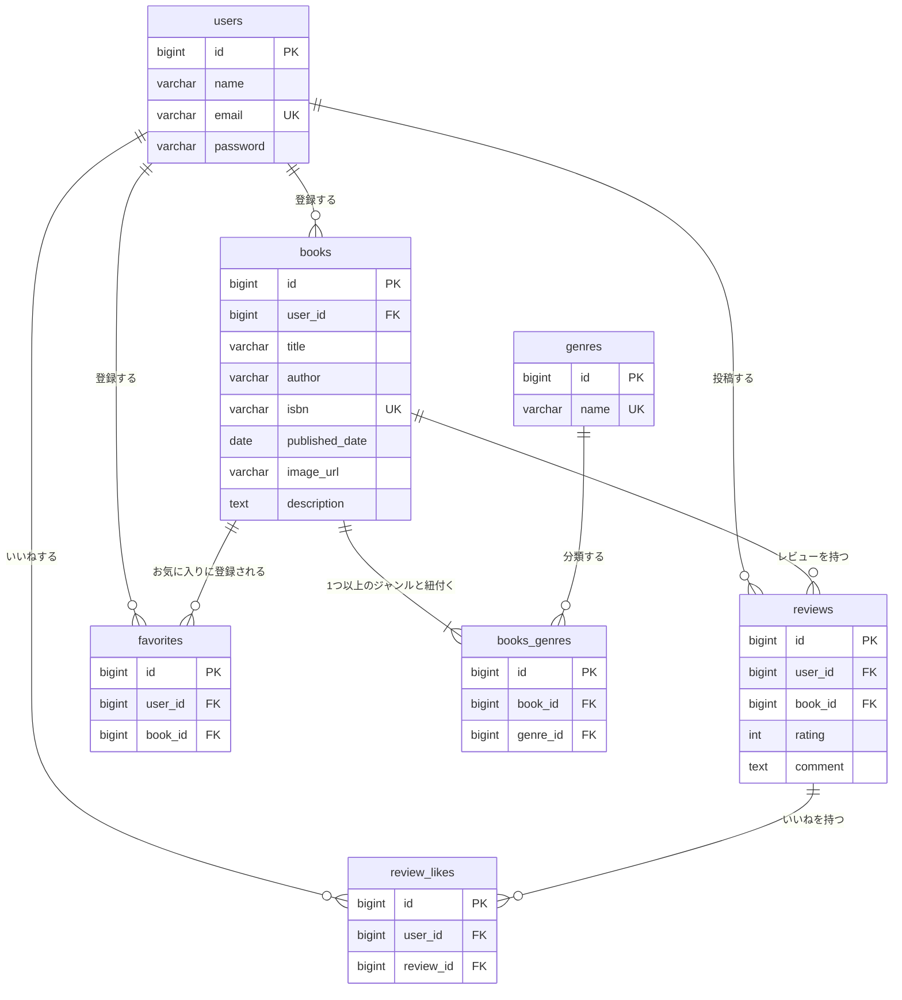

# データ設計

作成日: 2026-11-14 / 参照資料反映日: 2026-11-15

## 範囲・根拠

- 配置は [README.md](README.md)、対象機能は [features.md](features.md)、決定事項は [questions.md](questions.md)、画面項目は [screens.md](screens.md) に従う。基本要件のみを対象とする。
- ユーザーの追加指示により、**`docs/reference/` も根拠に含める**。物理定義は [シート11：データ要件](../reference/bookshelf-spec/sheet-11.html)・[シート12：テーブル仕様書](../reference/bookshelf-spec/sheet-12.html) を基にする。以下ではS11・S12と略す。「行」はシート左端の番号。
- [QA](../reference/bookshelf-spec/qa.html)・確認事項の確定回答・ユーザー決定を、要件シートの未反映箇所より優先する。シート12の表記誤り・欠落は明記し、未指定項目は推測で補わない。
- Q-20に従い、書籍・レビューを物理削除し、関連行を `ON DELETE CASCADE` で自動削除する。ジャンル側はQ-21の回答により `ON DELETE RESTRICT` とする。
- 本書はER図・物理テーブル定義・CRUDを扱う。認可・遷移・フラッシュは既存設計を維持する。未確定事項が残るため、実行可能なDDLが完成したことは示さない。

### 参照資料からの反映・修正

| 対象 | 反映内容・優先する根拠 |
|---|---|
| 物理名・型・主キー・共通列 | S12から反映。各業務テーブルは `id` 主キー、型は `bigint unsigned`。中間テーブルも専用ID＋組の一意制約とする。 |
| 書籍のジャンル | 最新S12で単一 `books.genre_id` は削除済み。Q-10とS12 行49〜54の `books_genres` による多対多が一致する。 |
| 出版日・画像URL | S12 行28〜29は `published_date`・`image_url` へ修正済みで、Q-11と一致する。型はdate・varchar(255)。 |
| いいね | S12 行56は `review_likes` へ修正済みで、Q-11と一致する。列・型・主キー・日時列はS12 行57〜61を反映。 |
| ISBN・画像URLの型 | 最新S12 行27・29の `varchar(13)`・`varchar(255)` を反映。旧版の型名誤記は解消済み。 |
| 書籍の更新日時 | S12 行32に `updated_at` が追加済み。timestamp列として反映し、未確定事項から除く。 |
| ジャンル名の一意性 | Q-04の一意条件を `UNIQUE(name)` として記載。指定の比較ルールを満たす照合順序・実装方法は未確定。 |
| コメント | Q-04の必須・1,000文字以内に加え、S12 行38にNOT NULLが反映済み。text・NOT NULLとして定義する。 |
| ジャンル参照の削除動作 | S12 行52は `restrictOnDelete()` に修正済みで、Q-21のRESTRICTと一致する。書籍側はCASCADE。 |
| ユーザー参照の削除動作 | S12 行24・35・44・58に明記されたCASCADEを反映。ユーザー削除機能を追加する意味ではない。 |

## テーブル一覧

T番号は本書内の対応番号。

| ID | 物理テーブル名 | 内容 | 根拠 |
|---|---|---|---|
| T1 | `users` | 利用者・認証情報 | S11 DR07、S12 行6〜14 |
| T2 | `books` | 書籍情報・作成者 | S11 DR01、S12 行22〜32、Q-10〜11 |
| T3 | `genres` | 全ユーザー共通ジャンル | S11 DR02、S12 行17〜21、Q-03〜04 |
| T4 | `books_genres` | 書籍とジャンルの中間行 | S11 DR03、S12 行49〜54、Q-10・21 |
| T5 | `reviews` | 書籍へのレビュー | S11 DR04、S12 行33〜40、Q-04・08 |
| T6 | `favorites` | ユーザーのお気に入り書籍 | S11 DR05、S12 行42〜47 |
| T7 | `review_likes` | ユーザーによるレビューへのいいね | S11 DR06、S12 行56〜61、Q-11 |
| 補助 | 詳細未確定 | パスワードリセット等の認証補助・標準管理データ | S11 DR08、S12 行63、Q-17 |

## ER図

物理テーブル名で記載する。図の `bigint` は表定義の `bigint unsigned` の略記。属性はキーと主要項目を示し、全列・NULL可否は後述の定義書を参照する。認証補助は具体構成が未確定のため図に追加しない。

- 各書籍は作成者1人、各レビューは投稿者1人と対象書籍1冊に属する。お気に入り・いいねも利用者1人と対象1件に属する。
- 書籍のジャンル1つ以上は登録・編集時の業務条件（Q-04）。外部キーだけでこの最小件数を保証するという意味ではない。
- 複合UNIQUEは `books_genres(book_id, genre_id)`・`favorites(user_id, book_id)`・`review_likes(user_id, review_id)`。複合主キーではない。レビューのユーザー／書籍の組には一意制約を設けない（Q-08）。

## テーブル定義書

### 共通の読み方

- 「NOT NULL」はS12の○を「○」、明示的なNULL許可を「可（NULL許可）」、空欄を「未記載」として転記する。空欄だけでNULL許可・禁止を確定しない。
- 既定値、時刻の精度・タイムゾーン、文字コード・照合順序、追加索引、ON UPDATE動作は未指定。`timestamp` に現在時刻の自動設定を推測で付けない。
- `id` は全7表とも `bigint unsigned` の主キー。S12 行7は `users.id` に `$table->id()` を明記している。その他のID採番方法は明記がないため、型・主キーの確定と区別する。
- 日時列はS12に列挙されたものを反映する。`$table->timestamps()` の補足はあるが、SQLのNULL・既定値まで独自に展開しない。
- 業務上の文字数・形式・必須条件はQ-04および画面設計に従う。SQL型の保存容量と入力上限は別に扱う。

### T1 `users`

根拠: S12 行6〜15、S11 DR07、F-01〜02、Q-04・17。

| 列 | 型 | NOT NULL | キー・用途・条件 |
|---|---|---|---|
| `id` | bigint unsigned | ○ | PK。`$table->id()` |
| `name` | varchar(255) | ○ | 名前。入力必須・255文字以内 |
| `email` | varchar(255) | ○ | UNIQUE。入力必須・メール形式・255文字以内 |
| `email_verified_at` | timestamp | 可（NULL許可） | S12の標準列。メール認証フローを追加する意味ではない |
| `password` | varchar(255) | ○ | ハッシュ保存。入力必須・8文字以上・確認一致 |
| `remember_token` | varchar(100) | 可（NULL許可） | S12の標準列。ログイン画面に記憶用の入力を追加しない |
| `created_at` | timestamp | 未記載 | 作成日時 |
| `updated_at` | timestamp | 未記載 | 更新日時 |

確認用パスワードは保存しない。二要素認証用3列はS12 行15により不要。標準列を保持することと、今回の画面・機能範囲を区別する。

### T2 `books`

根拠: S12 行22〜32、S11 DR01、F-04〜09・21〜26、Q-04・07・10〜11・15。

| 列 | 型 | NOT NULL | キー・用途・条件 |
|---|---|---|---|
| `id` | bigint unsigned | ○ | PK。詳細・更新・削除の識別子、並び順の同日時・同点解決 |
| `user_id` | bigint unsigned | ○ | FK→`users.id`、ON DELETE CASCADE。Web登録はログインユーザー。APIは登録・更新とも指定必須、更新時の変更可否はQ-18保留 |
| `title` | varchar(255) | ○ | タイトル。入力必須・255文字以内 |
| `author` | varchar(255) | ○ | 著者。入力必須・255文字以内 |
| `isbn` | varchar(13) | ○ | UNIQUE。入力はハイフンなし半角数字13桁。自身を除外して更新時の一意性検証。自動変換・チェックディジット検証なし |
| `published_date` | date | ○ | 出版日。入力必須、未来日可 |
| `image_url` | varchar(255) | 未記載 | 画像URL。任意・255文字以内・HTTP／HTTPS |
| `description` | text | 未記載 | 説明。任意・5,000文字以内 |
| `created_at` | timestamp | 未記載 | 登録日時。一覧・ジャンル内書籍の登録日時降順に使用 |
| `updated_at` | timestamp | 未記載 | 更新日時。S12 行32で追加済み |

`genre_id` は置かない。最新S12では単一ジャンル列が削除され、`created_at`・`updated_at` の両方が列挙されている。平均評価・レビュー件数の保存用列は資料にないため追加しない。

### T3 `genres`

根拠: S12 行17〜21、S11 DR02、F-09〜14、Q-03〜04・15。

| 列 | 型 | NOT NULL | キー・用途・条件 |
|---|---|---|---|
| `id` | bigint unsigned | ○ | PK。一覧はID昇順 |
| `name` | varchar(255) | ○ | Q-04の一意条件をUNIQUEとして反映。入力必須・255文字以内、更新時は自身除外。前後空白除去・全角半角を区別・英字大小を区別せず重複判定 |
| `created_at` | timestamp | 未記載 | 作成日時 |
| `updated_at` | timestamp | 未記載 | 更新日時 |

一意性の比較ルールを満たす照合順序・実装方法は未確定。全ユーザー共通で所有者列は設けない。書籍数の保存用列は追加しない。

### T4 `books_genres`

根拠: S12 行49〜54、S11 DR03、F-06〜09・14、Q-10・12・20〜21。

| 列 | 型 | NOT NULL | キー・用途・条件 |
|---|---|---|---|
| `id` | bigint unsigned | ○ | PK |
| `book_id` | bigint unsigned | ○ | FK→`books.id`、ON DELETE CASCADE |
| `genre_id` | bigint unsigned | ○ | FK→`genres.id`、**ON DELETE RESTRICT（Q-21）** |
| `created_at` | timestamp | 未記載 | 作成日時 |
| `updated_at` | timestamp | 未記載 | 更新日時 |

`UNIQUE(book_id, genre_id)`。物理名はS12どおり `books_genres` とし、別の慣習的な名前に置き換えない。ジャンル選択は既存IDを1つ以上、重複指定は拒否（Q-04）。

### T5 `reviews`

根拠: S12 行33〜40、S11 DR04、F-05・15〜18・23、Q-04・08・12・15・20。

| 列 | 型 | NOT NULL | キー・用途・条件 |
|---|---|---|---|
| `id` | bigint unsigned | ○ | PK |
| `user_id` | bigint unsigned | ○ | FK→`users.id`、ON DELETE CASCADE。投稿者 |
| `book_id` | bigint unsigned | ○ | FK→`books.id`、ON DELETE CASCADE |
| `rating` | int | ○ | 評価。入力必須・整数1〜5。DBのCHECK制約は未指定 |
| `comment` | text | ○ | 入力はQ-04により必須・1,000文字以内。S12 行38でもNOT NULLを明記 |
| `created_at` | timestamp | 未記載 | 投稿日時。登録日時降順で全件表示 |
| `updated_at` | timestamp | 未記載 | 更新日時 |

`UNIQUE(user_id, book_id)` は設けない。同じユーザーが同じ書籍へ複数投稿できる。本人編集・削除の条件はアプリ側で適用する。

### T6 `favorites`

根拠: S12 行42〜47、S11 DR05、F-19〜20、Q-12・15・20。

| 列 | 型 | NOT NULL | キー・用途・条件 |
|---|---|---|---|
| `id` | bigint unsigned | ○ | PK |
| `user_id` | bigint unsigned | ○ | FK→`users.id`、ON DELETE CASCADE |
| `book_id` | bigint unsigned | ○ | FK→`books.id`、ON DELETE CASCADE |
| `created_at` | timestamp | 未記載 | お気に入り追加日時。自分の登録分をこの日時の降順で表示 |
| `updated_at` | timestamp | 未記載 | 更新日時 |

`UNIQUE(user_id, book_id)`。利用者／書籍ごとの登録状態を追加・解除で切り替える。

### T7 `review_likes`

根拠: S12 行56〜61、S11 DR06、F-18、Q-09・11〜12・20。

| 列 | 型 | NOT NULL | キー・用途・条件 |
|---|---|---|---|
| `id` | bigint unsigned | ○ | PK |
| `user_id` | bigint unsigned | ○ | FK→`users.id`、ON DELETE CASCADE |
| `review_id` | bigint unsigned | ○ | FK→`reviews.id`、ON DELETE CASCADE |
| `created_at` | timestamp | 未記載 | 作成日時 |
| `updated_at` | timestamp | 未記載 | 更新日時 |

`UNIQUE(user_id, review_id)`。最新S12の表名・組の一意制約はQ-11と一致する。自分のレビューにもいいねできる。

### 補助：標準の認証補助・管理データ

S11 DR08はパスワードリセット・パーソナルアクセストークン・失敗ジョブを挙げ、S12 行63は `password_resets 等`・`id / token等`・型「各種」・Laravel標準マイグレーションという概略のみ。**具体的な全テーブル・各列・型・キーは埋められない**。標準マイグレーションを利用する方針はQ-17で確定している。

セッション保存先も未指定のため、セッション用DBテーブルの存在・CRUDを確定しない。これらの標準データが挙げられていても、パスワード再設定・メール認証フロー・Sanctum認証・二要素認証などを今回の利用者向け機能に追加しない。

## 外部キーと親削除時の動作

物理外部キーとON DELETEを次のとおり記載する。ユーザー参照はS12、書籍・レビューの関連行はS12とQ-20、ジャンル側はQ-21を根拠とする。

| 子の列 | 参照先の親 | ON DELETE | 根拠 |
|---|---|---|---|
| `books.user_id` | `users.id` | CASCADE | S12 行24 |
| `reviews.user_id` | `users.id` | CASCADE | S12 行35 |
| `favorites.user_id` | `users.id` | CASCADE | S12 行44 |
| `review_likes.user_id` | `users.id` | CASCADE | S12 行58、Q-11 |
| `reviews.book_id` | `books.id` | CASCADE | S12 行36、Q-20 |
| `favorites.book_id` | `books.id` | CASCADE | S12 行45、Q-20 |
| `books_genres.book_id` | `books.id` | CASCADE | S12 行51、Q-20 |
| `review_likes.review_id` | `reviews.id` | CASCADE | S12 行59、Q-11・20 |
| `books_genres.genre_id` | `genres.id` | **RESTRICT** | S12 行52、Q-12・21 |

書籍削除はレビュー→いいねまで連鎖し、お気に入り・書籍ジャンルも削除する。中間行を消してもジャンル本体は消さない。レビュー単独削除はそのいいねだけを連鎖削除する。

ジャンル削除はアプリで紐付きを確認し、Q-02の確定メッセージを表示する。確認後に紐付けが追加された場合もRESTRICTで拒否し、同じ削除不可の結果として扱う。ユーザー削除機能は今回のF一覧にないが、DBでユーザーを削除した場合には上記制約による広い連鎖削除が発生することに注意する。

## CRUD表

列は上記の物理テーブル。機能上必要な操作を示す。

- C=作成、R=参照、U=更新、D=削除。`D連` はDBのCASCADEによる削除。`C/D` は登録状態に応じてどちらかを行うトグル。
- Rは取得・存在／一意性検証・対象の本人判定・集計を含む。共通認証やナビの参照、リダイレクト先の別機能による再取得は重複計上しない。実際のSQLの本数・JOIN方式を決める表ではない。
- `—` は業務データの操作なし、`未確定` は資料から操作を決められない、`対象外` は単一業務のCRUDとして分類しないことを示す。
- F-06・07のジャンル関連操作はF-09と重複する。関係の更新は中間行の追加C・解除Dとして記載し、独立した保存画面を追加する意味ではない。

| 機能 | users | books | genres | books_genres | reviews | favorites | review_likes | 認証補助（詳細未確定） |
|---|---|---|---|---|---|---|---|---|
| F-01 会員登録 | RC | — | — | — | — | — | — | 未確定 |
| F-02 ログイン | R | — | — | — | — | — | — | 未確定 |
| F-03 ログアウト | — | — | — | — | — | — | — | 未確定 |
| F-04 書籍一覧 | — | R | R | R | R | — | — | — |
| F-05 書籍詳細・レビュー閲覧 | R | R | R | R | R | R | R | — |
| F-06 書籍登録 | — | RC | R | C | — | — | — | — |
| F-07 書籍編集 | — | RU | R | RCD | — | — | — | — |
| F-08 書籍削除 | — | RD | — | D連 | D連 | D連 | D連 | — |
| F-09 ジャンル紐付け | — | R | R | RCD | — | — | — | — |
| F-10 ジャンル一覧 | — | — | R | R | — | — | — | — |
| F-11 ジャンル詳細 | — | R | R | R | — | — | — | — |
| F-12 ジャンル登録 | — | — | RC | — | — | — | — | — |
| F-13 ジャンル編集 | — | — | RU | — | — | — | — | — |
| F-14 ジャンル削除 | — | — | RD | R | — | — | — | — |
| F-15 レビュー投稿 | — | R | — | — | C | — | — | — |
| F-16 レビュー編集 | — | R | — | — | RU | — | — | — |
| F-17 レビュー削除 | — | — | — | — | RD | — | D連 | — |
| F-18 レビューへのいいね | — | — | — | — | R | — | R・C/D | — |
| F-19 お気に入り登録・解除 | — | R | — | — | — | R・C/D | — | — |
| F-20 お気に入り一覧 | — | R | — | — | — | R | — | — |
| F-21 評価ランキング | — | R | — | — | R | — | — | — |
| F-22 API書籍一覧 | — | R | R | R | R | — | — | — |
| F-23 API書籍詳細 | R | R | R | R | R | — | — | — |
| F-24 API書籍登録 | R | RC | R | C | — | — | — | — |
| F-25 API書籍更新 | R | RU※ | R | RCD | — | — | — | — |
| F-26 API書籍削除 | — | RD | — | D連 | D連 | D連 | D連 | — |
| F-27 初期データ投入 | RC | RC | RC | RCD | C | RC | RC | — |
| F-28 基本テスト | 対象外 | 対象外 | 対象外 | 対象外 | 対象外 | 対象外 | 対象外 | 対象外 |

- F-05のT6・T7は、認証済み利用者の登録状態やいいね件数の表示に対応する。SC-02のゲスト／認証済みの表示条件に従う。
- F-10の書籍数はT4の関連件数として参照できる。T2の実体取得を必須とするものではない。F-20はSC-10の項目に従い、ジャンル・レビューの参照を追加しない。
- F-14のDは紐付きがない場合のみ。紐付きがあれば削除を拒否し、T3・T4とも削除しない。
- F-25の `RU※` は書籍情報の更新。作成者 `user_id` の変更可否はQ-18未確定で、Uから変更可能と解釈しない。
- F-27は機能一覧の初期データ表にある `firstOrCreate`・`sync`・`create`・`syncWithoutDetaching` の操作範囲。レビューの事前削除は追加せず、T5にDを付けない。指定されていないユーザー・ジャンル・書籍の既存値更新も加えない。
- F-28は検証要件であり、単一の業務CRUDではない。テストの準備・実行・後片付けを根拠なく各セルに展開しない。

## 埋まらなかった箇所

2026-11-15更新のS12を反映し、7業務テーブル・44列の物理定義を照合した。ISBNの型・書籍の更新日時・コメントのNOT NULL・ジャンル側RESTRICTは反映済み。次は資料の未指定として残る。

| 箇所 | 埋まらなかった内容 | 影響・確認時点 |
|---|---|---|
| DBの具体構成 | DB製品・バージョン・文字コード・照合順序 | スキーマ実装前。型の記法だけで製品・バージョンまで確定しない |
| NOT NULL欄の空欄 | 各日時列、books.image_url・descriptionのSQL上のNULL可否 | 上記定義表の「未記載」を確認。reviews.commentは最新S12でNOT NULL確定済み |
| 既定値・日時 | 各列の既定値、日時の精度・タイムゾーン・自動設定 | SQL実装前に確認。timestampに自動の現在時刻設定を追加しない |
| ID採番 | users.id以外の具体的な採番方法 | id主キー・bigint unsignedは確定。採番方法を実装前に確認 |
| ジャンル名・メール等の比較 | 特に全角半角を区別・英字大小を区別しないジャンル名の照合順序・比較方法 | 一意性の実装前。UNIQUEと業務上の比較ルールを整合させる |
| その他の制約・索引 | ratingのDB CHECK、ON UPDATE、追加索引 | 資料に未指定。入力検証・外部キー・確定UNIQUEとは区別する |
| 認証補助／CRUD F-01〜03 | 標準テーブルの具体構成、セッション保存先、対応するCRUD | S11・S12も概略のみ。認証構成を決める際に確認 |
| CRUD F-25 | 更新APIの作成者変更可否 | Q-18の回答後に反映 |
| CRUD F-28 | 単一の業務CRUDへ分類できない | 対象外と明示。テスト設計で扱う |

Q-19のエラー文言・表示先は別途保留。書籍のISBN13桁、コメント必須等の確定入力条件は維持する。参考資料の控えやアプリのコードを変更したことを示すものではない。
