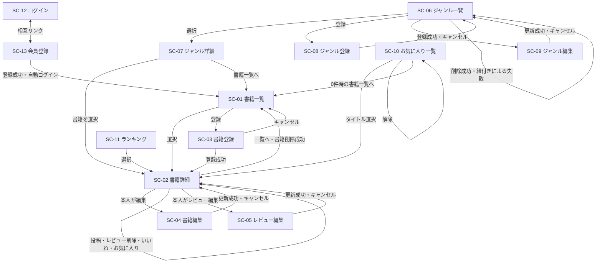

# 画面設計

作成日: 2026-11-14 / 最終整理日: 2026-11-17

## 前提・根拠

共通方針は [README.md](README.md)、対象はF-01〜21の基本13画面。完成済みBladeを維持し、サーバー側で確定条件を満たす。Q-18・19・23・24とQ-22の未回答部分は未確定で、具体案・確認先は [questions.md](questions.md) に集約する。経路の詳細は [permissions-api.md](permissions-api.md#webルーティング一覧)、物理定義はdata.mdを参照する。

### 根拠と照合結果

構成・導線は現Blade、遷移はQ-01、入力条件はQ-04、文言はQ-02・05、認可はQ-03を採用。投稿・お気に入り登録は詳細内の操作で、独立画面は作らない。welcome.blade.php・共通部品は画面番号の対象外。応用・認証補助の利用者向け画面も追加しない。

QA Q-16の質問文は「ログイン画像にパスワード欄が見えない」とするが、[画像14](../reference/bookshelf-spec/resources/image_1044466353_14.jpg)には存在し、通常のパスワード欄がないのは[登録画像13](../reference/bookshelf-spec/resources/image_1044466353_13.jpg)。控えは変更せず、確定回答どおり現Bladeの4項目／2項目と相互導線を維持する。再確認は不要。

## 画面一覧

Bladeのパスは `resources/views/` 配下。本人は書籍作成者またはレビュー投稿者を指す。画面内操作の条件は後述。

| ID | 画面 | ルート名 | 閲覧条件 | Blade | 機能 |
|---|---|---|---|---|---|
| SC-01 | 書籍一覧 | books.index（`/`） | 公開 | books/index.blade.php | F-04 |
| SC-02 | 書籍詳細 | books.show | 公開 | books/show.blade.php | F-05・07〜08・15〜19 |
| SC-03 | 書籍登録 | books.create | 認証 | books/create.blade.php・books/_form.blade.php | F-06・09 |
| SC-04 | 書籍編集 | books.edit | 認証＋本人 | books/edit.blade.php・books/_form.blade.php | F-07・09 |
| SC-05 | レビュー編集 | reviews.edit | 認証＋本人 | reviews/edit.blade.php | F-16 |
| SC-06 | ジャンル一覧 | genres.index | 認証 | genres/index.blade.php | F-10・14 |
| SC-07 | ジャンル詳細 | genres.show | 認証 | genres/show.blade.php | F-11 |
| SC-08 | ジャンル登録 | genres.create | 認証 | genres/create.blade.php | F-12 |
| SC-09 | ジャンル編集 | genres.edit | 認証 | genres/edit.blade.php | F-13 |
| SC-10 | お気に入り一覧 | favorites.index | 認証・自分の登録分 | favorites/index.blade.php | F-19〜20 |
| SC-11 | 評価ランキング | ranking.index | 公開 | ranking/index.blade.php | F-21 |
| SC-12 | ログイン | login（`/login`） | ゲスト向け | auth/login.blade.php | F-02 |
| SC-13 | 会員登録 | register（`/register`） | ゲスト向け | auth/register.blade.php | F-01 |

## 画面遷移図

下図は利用条件を満たした通常遷移。削除・いいね等は独立画面を作らず、元画面内で操作する。

- **共通ナビ（SC-01〜11）：** 書籍一覧・ロゴ、ランキング、書籍登録、お気に入り、ジャンル管理。ゲストにも保護画面のリンクを表示する。認証済みは名前・ログアウト、モバイルではメールも表示してメニュー開閉。ゲストはログイン・新規登録。PC・モバイルの遷移先は同じ。
- **認証：** SC-03〜10へのゲストアクセスは `/login`。ログイン成功は元の保護ページ、なければ `/`。詳細内のログインリンクから入ってもリンク元への復帰は別途保証しない。認証済みでSC-12・13へ来た場合は `/`、ログアウト後は `/login`。
- **認証画面：** 共通ナビなし。ゲストレイアウトのロゴは `/`、相互リンクはSC-12・13。
- **入力不正：** 元フォームへ戻り、パスワード・確認入力以外とジャンル選択を保持する。確認不一致・認証失敗の対応項目はQ-19で保留。
- **削除・拒否：** 確認は現Bladeの「本当に削除しますか？」。中止時は送信せず元画面。認証後も他人の編集・更新・削除は403、対象なし404。独自の403・404画面は作らない。SC-10の解除後ページ補正はQ-24で未確定。

## 画面項目定義

代表はSC-01・02・03・08・13。入力条件・エラーは次節に集約し、編集と繰り返し画面は差分で示す。

### SC-01 書籍一覧

全書籍を登録日時降順・同日時ID降順、10件／ページで表示。カードは表紙・タイトル・著者・複数ジャンルを持ち、全体が詳細リンク。表紙のaltはタイトル、未設定は「画像なし」。レビューありのみ、四捨五入した星と平均の小数1桁を表示する。登録リンク・ページリンク・成功フラッシュ枠があり、0件は「書籍が登録されていません。」。

### SC-02 書籍詳細

| 項目・操作 | 表示・動作 |
|---|---|
| 書籍情報 | 表紙・タイトル・著者・ISBN・出版日・複数ジャンル。説明は値がある場合のみ。altはタイトル、画像未設定は「画像なし」 |
| お気に入り | 認証済みはハートの状態で追加／解除。ゲストはログインリンク。操作後は同画面、フラッシュなし |
| 書籍の編集・削除 | 作成者本人だけ表示。編集→SC-04、削除成功→SC-01。削除前に確認 |
| 投稿フォーム | 認証済みだけ表示。ratingは初期値が空の「選択してください」、5〜1の星・整数を選択。commentは空のテキストエリア。エラー時は保持、投稿成功→同画面。同じ書籍へ複数投稿可 |
| ゲストの投稿案内 | 「レビューを投稿するにはログインしてください。」のログインリンク |
| レビュー一覧 | 登録日時降順・全件、ページ分割なし。投稿者名・星・コメント（値がある場合）・投稿日 `Y/m/d`。0件は「まだレビューはありません。」 |
| いいね | 件数と「いいね」「いいね済み」。自分のレビューも可。ゲストは件数付きログインリンク。操作後は同画面、フラッシュなし |
| レビューの編集・削除 | 投稿者本人だけ表示。編集→SC-05、削除成功→同画面。削除前に確認 |
| 戻る・結果 | 「一覧に戻る」→SC-01。成功フラッシュと項目別入力エラーを表示 |

削除範囲・CASCADEは [data.md](data.md#外部キーと親削除時の動作) を参照。書籍作成者も他人のレビューを編集・削除できない。

### SC-03 書籍登録（SC-04と共通）

初期値は空・ジャンル未選択、エラー時は入力を保持。作成者IDは入力せずログインユーザーから設定する。

| 表示名／項目名 | 入力形式・補足 |
|---|---|
| タイトル／title・著者／author | テキスト。プレースホルダーは書籍タイトル・著者名の入力案内 |
| ISBN-13／isbn | テキスト、例9784000000000。「13桁のISBNコードを入力してください」の補足 |
| 出版日／published_date | 日付。Q-25に従いモデルからYYYY-MM-DD文字列で渡す |
| 説明／description | テキストエリア。「書籍の説明を入力（任意）」 |
| 画像URL／image_url | テキスト、例https://example.com/image.jpg。表紙画像URL・任意の補足。アップロード欄なし |
| ジャンル／genres[] | 既存ジャンルの複数チェック。0件は「ジャンルが登録されていません。先にジャンルを登録してください。」、案内内リンクなし |
| 登録・キャンセル | 登録成功→SC-02、キャンセル→SC-01 |

### SC-08 ジャンル登録（SC-09と共通）

ジャンル名nameのテキスト欄、初期値は空、入力エラー時は保持して欄下に表示。「登録」成功・「キャンセル」ともSC-06へ。

### SC-13 会員登録

お名前name・メールemailはテキスト、password・password_confirmationはパスワード入力。初期値は空、エラー時は名前・メールのみ保持。4項目に欄下エラー枠があり、確認不一致の対応項目はQ-19未確定。「登録」成功→自動ログイン・SC-01、「ログイン」→SC-12。

### その他の画面の差分

| 画面 | 引継元と固有条件 |
|---|---|
| SC-04 書籍編集 | SC-03と同項目。既存値・紐付きジャンルを初期表示、エラー時は入力優先。「更新」成功・キャンセル→SC-02 |
| SC-05 レビュー編集 | SC-02の入力条件。対象書籍タイトル、評価は1〜5のラジオ、コメントはテキストエリア。既存値を初期表示、エラー時は入力優先。「更新する」成功・キャンセル→SC-02 |
| SC-06 ジャンル一覧 | SC-08の管理入口。ID昇順に名前リンク・書籍数・編集／削除、登録リンク。成功・失敗枠と削除確認。0件は「ジャンルが登録されていません。」 |
| SC-07 ジャンル詳細 | SC-01のカードから平均評価・登録ボタンを除く。見出しにジャンル名、カードの対象ジャンルを強調。紐付き書籍を登録日時降順・10件／ページ。0件は「このジャンルの書籍はまだ登録されていません。」、戻る先はSC-01 |
| SC-09 ジャンル編集 | SC-08と同項目。既存名を初期表示、エラー時は入力優先。「更新」成功・キャンセル→SC-06 |
| SC-10 お気に入り一覧 | SC-01と異なり自分の追加日時降順・10件／ページ。画像・タイトルリンク・著者・ISBN・解除ボタン。解除後同画面、ページ補正はQ-24未確定。0件は「お気に入りに登録された書籍はありません。」と「書籍一覧を見る」→SC-01。画像なしは「No Image」 |
| SC-11 評価ランキング | SC-01と異なりレビューありのみ最大10冊・連番。未丸め平均降順→件数降順→書籍ID昇順。順位・画像・タイトル・著者・平均・レビュー件数、詳細リンク。星隣は小数2桁、バッジは1桁。画像なしは「No Image」、0件は「まだレビューが投稿された書籍がありません。」 |
| SC-12 ログイン | SC-13から名前・確認入力を除き、emailはメール形式の入力欄。エラー時はメールのみ保持。「ログイン」、SC-13への「会員登録」。登録用の255文字・8文字条件はログインへ追加しない |

## 入力チェックとエラーメッセージ

Q-04・05の確定条件の詳細を本節へ集約する。全フォームはnovalidate、ブラウザ標準文言に代用せず、サーバー側で日本語エラーを入力欄下へ表示する。FormRequestへの分離とmessages()はS8の指定。検証条件は確定、**「未確定（Q-19）」の文言・対応項目は想定案を採用した状態ではない**。

| 対象 | 確定した入力条件 | 確定文言／未確定箇所 |
|---|---|---|
| title・author（SC-03・04） | 必須、各255文字以内 | title必須「タイトルは必須です。」、その他は未確定（Q-19） |
| isbn（SC-03・04） | 必須、ハイフンなし半角数字13桁、一意。更新は自身除外。自動変換・チェックディジット検証なし | 桁数「ISBNは13桁で入力してください。」、重複「そのISBNは既に使用されています。」、必須・文字種は未確定（Q-19） |
| published_date（SC-03・04） | 必須、有効日付、未来日可 | 未確定（Q-19） |
| description（SC-03・04） | 任意、5,000文字以内 | 未確定（Q-19） |
| image_url（SC-03・04） | 任意、255文字以内、HTTP／HTTPS | 未確定（Q-19） |
| genres（SC-03・04） | 既存IDを1つ以上、重複不可。ジャンル0件時は登録案内 | 未選択・不正ID・重複は未確定（Q-19）。genresとgenres.*の欄下表示枠あり |
| rating（SC-02・05） | 必須、整数1〜5 | 必須・整数・範囲は未確定（Q-19） |
| comment（SC-02・05） | 必須、1,000文字以内。投稿回数制限なし | 必須・超過は未確定（Q-19） |
| ジャンルname（SC-08・09） | 必須、255文字以内、一意。前後空白除去、全半角区別・英字大小同一。更新は自身除外 | 必須・超過・重複は未確定（Q-19） |
| 登録name（SC-13） | 必須、255文字以内 | 未確定（Q-19） |
| 登録email（SC-13） | 必須、メール形式、255文字以内、一意 | 未確定（Q-19） |
| 登録password・確認（SC-13） | パスワード必須・8文字以上・確認入力と一致。両パスワードを保持しない | 文言・確認不一致の対応項目は未確定（Q-19） |
| ログインemail・password（SC-12） | メール必須・メール形式、パスワード必須 | 入力エラー文言は未確定（Q-19） |
| ログイン認証不一致（SC-12） | メールとパスワードで認証 | 「ログイン情報が登録されていません。」。欄下は確定、対応項目は未確定（Q-19） |

Webのuser_idは入力対象外。APIの項目別errors・JSONはpermissions-api.mdで扱う。Q-19の文言案・フォーム上部表示の参考候補を確定として転記しない。

### 操作結果とエラーの扱い

| 操作 | 遷移・表示 |
|---|---|
| 書籍登録／更新／削除 | 詳細／詳細／一覧。「書籍を登録しました。」「書籍情報を更新しました。」「書籍を削除しました。」 |
| レビュー投稿／更新／削除 | 対象詳細。「レビューを登録しました。」「レビューを更新しました。」「レビューを削除しました。」 |
| ジャンル登録／更新／削除 | ジャンル一覧。「ジャンルを登録しました。」「ジャンルを更新しました。」「ジャンルを削除しました。」 |
| 紐付きジャンル削除失敗 | 一覧の失敗枠。「このジャンルには書籍が紐付いているため削除できません。」。RESTRICT競合も同じ |
| お気に入り・いいね | 操作元で状態・件数を再表示、フラッシュなし |
| ゲストの保護画面・他人操作・対象なし | ログイン誘導・403・404。追加の専用案内文言は定義しない |

## 実装時に照合すること

- **現Bladeの表示維持：** 投稿の評価・投稿／編集のコメントに必須マークがなくても、サーバー側で必須とする。maxlength等の属性不足でも確定上限を適用する。「No Image」の日本語化も行わない。
- **全解除時の保持：** old('genres', $bookGenreIds)で既存選択へ戻らないよう、未送信genresを空配列として検証・旧入力へ保存する案を開発側で検討。未選択の保持要件自体は確定済み。
- **未確定の受け渡し・遷移：** 出版日はQ-25、お気に入り解除で空ページになった場合はQ-24。全体件数とページ内件数を混同せず、回答後にバックエンドへ反映する。
