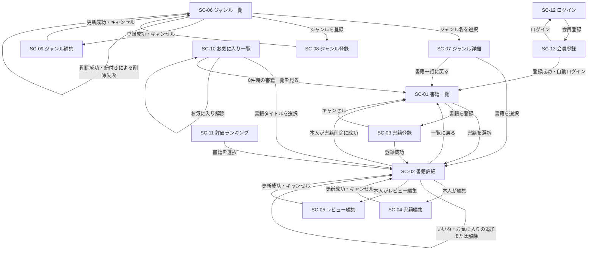
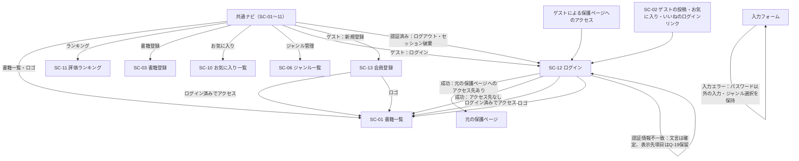

# 画面設計

作成日・再整理日: 2026-11-14

## 前提・根拠

- 配置と記載量は [README.md](README.md)、対象機能は [features.md](features.md) の基本要件、確定仕様は [questions.md](questions.md) のQ-01〜17に従う。Q-18〜19は後日確認であり、質問文の候補を確定仕様にしない。
- 画面の構成・入力形式・導線は、機能一覧で参照されている既存Bladeを照合する。Bladeと確定仕様が異なる場合は確定仕様を採用する。サーバー側の実装完了を示す資料ではない。
- `docs/reference/bookshelf-spec/` のREADME・QA・各要件シートと、画面の差に関係するUI画像も読み直した。ユーザーの追加指示（Q-21）により、referenceも根拠に含める。資料間に差がある場合はQAと確認事項の確定回答を優先する。本書は画面設計を扱い、物理データ定義は `data.md` に記載する。ワイヤーフレーム・画像ファイルは作成しない。
- URLは設計資料で明記済みの `/`・`/login`・`/register` のみを記載し、ほかはBladeのルート名で識別する。URLやHTTPメソッドの一覧は本書で新たに決めない。
- 2026-11-14のユーザー回答により、資料にないエラー文言は**未確定（要確認）**として残す。検証条件が確定していることと、表示文言が確定していることを区別する。
- Q-18（更新APIの登録者変更可否）は引き続き保留。APIは画面一覧の対象外であり、本書で仕様を確定しない。

### 根拠と照合結果

| 対象 | 設計上の根拠 | reference・Bladeとの照合での扱い |
|---|---|---|
| 対象画面 | F-01〜21、Q-16〜17 | 基本13画面。レビュー投稿・お気に入り追加は書籍詳細内の操作。応用画面は追加しない。 |
| 正常・異常時の遷移 | Q-01・03、F-02〜03 | 保存後の遷移はQ-01、キャンセル・戻るリンクは現Blade。独自の403・404画面は追加しない。 |
| 必須・文字数・形式 | Q-04・08〜11 | コメント必須、画像URL255文字以内など、回答後の条件を優先する。QAの質問時の原案を採用しない。 |
| 表示メッセージ | Q-02・05、Q-19 | 確定文言はそのまま使用。Q-19の文言例・表示先候補は未確定。お気に入り・いいねはフラッシュなし。 |
| 認証UI | F-01〜02、Q-16 | 現Bladeの4項目／2項目と相互リンクを維持。UI画像の導線文言へ置き換えない。 |
| 本人操作・削除 | Q-03・12 | 本人だけ編集・削除を表示し、直接アクセスも制限。書籍削除時は関連データを削除し、ジャンル本体は残す。 |

## 画面一覧

SC番号は本書内の識別子であり、既存のSC-01〜SC-13を維持する。レビュー投稿・お気に入り追加・削除操作・ログアウトは既存画面内の操作であり、独立画面を追加しない（F-03・08・14〜19、Q-16）。PC・モバイルの表示差でも別番号を増やさない。

| ID | 画面名 | ルート名／明記済みURL | 利用条件 | 対応Blade（`resources/views/` 配下） | 機能根拠 |
|---|---|---|---|---|---|
| SC-01 | 書籍一覧 | `books.index`／`/` | 公開 | `books/index.blade.php` | F-04 |
| SC-02 | 書籍詳細 | `books.show` | 公開。投稿・お気に入り・いいねは認証必須、書籍・レビューの編集削除は本人のみ | `books/show.blade.php` | F-05・07〜08・15〜19 |
| SC-03 | 書籍登録 | `books.create` | 認証必須 | `books/create.blade.php`・`books/_form.blade.php` | F-06・09 |
| SC-04 | 書籍編集 | `books.edit` | 認証＋作成者本人 | `books/edit.blade.php`・`books/_form.blade.php` | F-07・09 |
| SC-05 | レビュー編集 | `reviews.edit` | 認証＋投稿者本人 | `reviews/edit.blade.php` | F-16 |
| SC-06 | ジャンル一覧（ジャンル管理） | `genres.index` | 認証必須 | `genres/index.blade.php` | F-10・14 |
| SC-07 | ジャンル詳細 | `genres.show` | 認証必須 | `genres/show.blade.php` | F-11 |
| SC-08 | ジャンル登録 | `genres.create` | 認証必須 | `genres/create.blade.php` | F-12 |
| SC-09 | ジャンル編集 | `genres.edit` | 認証必須 | `genres/edit.blade.php` | F-13 |
| SC-10 | お気に入り一覧 | `favorites.index` | 認証必須。自分の登録分のみ | `favorites/index.blade.php` | F-19〜20 |
| SC-11 | 評価ランキング | `ranking.index` | 公開 | `ranking/index.blade.php` | F-21 |
| SC-12 | ログイン | `login`／`/login` | ゲスト向け。ログイン済みはSC-01へ | `auth/login.blade.php` | F-02 |
| SC-13 | 会員登録 | `register`／`/register` | ゲスト向け。ログイン済みはSC-01へ | `auth/register.blade.php` | F-01 |

`welcome.blade.php` は機能一覧で標準案内画面として区別されているため採番しない。共通レイアウト・部品も独立画面としない。検索・読書レポート・読書計画・通知・パスワード再設定・メール認証などの対象外画面は追加しない。

## 画面遷移図

### 主な導線と操作後の遷移

根拠: Q-01・16、F-01〜21、上記Bladeのリンク・キャンセル先。図は利用条件を満たす場合の遷移を示し、ゲストの保護画面アクセスは次の図でログインへ誘導する。自己ループは同一画面への再表示を示す。

### 共通ナビゲーション・認証・入力エラー

根拠: `layouts/navigation.blade.php`・`components/guest-layout.blade.php`、Q-01・03・05、F-01〜03。図の共通ナビ・保護ページ・フォームは説明用ノードであり、追加画面ではない。

- 共通ナビはPC・モバイルとも同じ遷移先。ゲストにも保護画面へのリンクがあり、アクセス時にログインへ誘導する。
- SC-03〜10の認証必須画面へのゲストアクセスはSC-12へ。SC-04・05の他人によるアクセスは、認証後も本人条件を満たさなければ403とする。
- 詳細内のログインリンクから入った場合も、成功後はQ-01の「元の保護ページへのアクセス先があればそこへ、なければ `/`」に従う。リンク元への復帰を別途保証する仕様は追加しない。
- 他人の書籍・レビューの編集・更新・削除は403、存在しない対象は404（Q-03）。エラー画面の独自デザイン・文言は資料にないため定義しない。
- 書籍・レビュー・ジャンル削除の確認は、既存Bladeの「本当に削除しますか？」。中止時は送信せず元画面に留まる。

## 画面項目定義

### 記載範囲と選定理由

詳細定義は次の5画面に絞る。ほかの画面は同じ項目の再掲を避け、差分だけを後述する（READMEの記載量方針）。

| 代表画面 | 選んだ理由 |
|---|---|
| SC-01 書籍一覧 | 主な閲覧入口で、書籍カード・平均評価・ページ分割・0件表示の基準となる。 |
| SC-02 書籍詳細 | レビュー閲覧と投稿、お気に入り、いいね、本人操作が集まるため、表示条件を明確にする必要がある。 |
| SC-03 書籍登録 | 入力項目が最も多く、任意項目とジャンル複数選択を含む。編集でも共通フォームを利用する。 |
| SC-08 ジャンル登録 | 書籍とは異なる、名前だけの共通マスタ登録と重複判定を押さえる。 |
| SC-13 会員登録 | パスワード保持の例外と確認入力があり、ログインとの差分も説明できる。 |

### SC-01 書籍一覧

根拠: F-04、Q-15、`books/index.blade.php`。

| 項目・操作 | 種別 | 表示・動作 |
|---|---|---|
| 書籍一覧 | 繰り返し表示 | 全書籍を登録日時降順、同日時はID降順。10件/ページ。 |
| 表紙・タイトル・著者・ジャンル | 書籍カード | 表紙未設定時は「画像なし」。画像の代替テキストはタイトル。ジャンルは複数表示。カード選択でSC-02へ。 |
| 平均評価 | 表示 | レビューがある場合のみ、丸めた星と小数1桁の数値を表示。 |
| 書籍を登録 | リンク | SC-03へ。ゲストはログイン誘導。 |
| ページリンク | リンク | 一覧のページを切り替える。 |
| 0件表示 | 表示 | 「書籍が登録されていません。」 |
| 成功メッセージ | 表示 | 書籍削除後など、成功フラッシュがある場合に表示。 |

### SC-02 書籍詳細

根拠: F-05・07〜08・15〜19、Q-01〜05・08〜09・15〜16、`books/show.blade.php`。

| 項目・操作 | 種別／項目名 | 表示・動作 |
|---|---|---|
| 表紙・タイトル・著者・ISBN・出版日・ジャンル・説明 | 表示 | ジャンルは複数、説明は値がある場合のみ。表紙未設定時は「画像なし」、画像の代替テキストはタイトル。 |
| お気に入り | トグル | 認証済みはハートの状態で追加済みかを示し、追加／解除後はSC-02へ戻る。ゲストはログインリンク。フラッシュなし。 |
| 書籍の編集・削除 | リンク／ボタン | 作成者本人にのみ表示。編集はSC-04、削除成功はSC-01へ。削除前に確認。 |
| レビュー評価 | 選択／`rating` | 認証済みに投稿フォームを表示。必須。初期値は空の「選択してください」、選択肢は5〜1の整数と星。エラー時は入力値を保持。 |
| レビューコメント | テキストエリア／`comment` | 必須、1,000文字以内。初期値は空、エラー時は入力値を保持。現Bladeの必須表示は未反映。 |
| 投稿する | 送信 | 成功後はSC-02。1ユーザーによる同じ書籍への複数投稿を許可。ゲストにはフォームの代わりにログイン案内を表示。 |
| レビュー一覧 | 繰り返し表示 | 登録日時降順で全件表示、ページ分割なし。投稿者名・評価の星・コメント・投稿日（`Y/m/d`）を表示。 |
| いいね | トグル／件数表示 | 「いいね」「いいね済み」と件数。自分のレビューにも操作可。ゲストは件数付きログインリンク。操作後はSC-02、フラッシュなし。 |
| レビューの編集・削除 | リンク／ボタン | 投稿者本人のみ表示。編集はSC-05、削除成功はSC-02へ。削除前に確認。 |
| レビュー0件表示 | 表示 | 「まだレビューはありません。」 |
| 一覧に戻る | リンク | SC-01へ。 |
| 成功・入力エラー | 表示 | 成功フラッシュを画面内に、入力エラーを該当入力欄の下に表示。 |

書籍削除ではレビュー・そのいいね・お気に入り・ジャンル紐付けも削除し、ジャンル本体は残す。レビュー削除ではそのいいねを削除する（Q-12）。画面から別の削除ページには遷移しない。

### SC-03 書籍登録（SC-04と共通）

根拠: F-06〜09、Q-01・04・10〜11、`books/create.blade.php`・`books/_form.blade.php`。入力欄は初期値が空、ジャンルは未選択。入力エラー時は入力値・選択を保持する。各条件の詳細は後述の入力チェック表を参照。

| 表示名 | 項目名 | 入力形式 | 必須 | 上限・表示等 |
|---|---|---|---|---|
| タイトル | `title` | テキスト | 必須 | 255文字。 |
| 著者 | `author` | テキスト | 必須 | 255文字。 |
| ISBN-13 | `isbn` | テキスト | 必須 | ハイフンなし半角数字13桁。「13桁のISBNコードを入力してください」の補足。 |
| 出版日 | `published_date` | 日付 | 必須 | 有効な日付。未来日可。 |
| 説明 | `description` | テキストエリア | 任意 | 5,000文字。 |
| 画像URL | `image_url` | テキスト | 任意 | 255文字、HTTP／HTTPS。ファイルアップロード欄は設けない。 |
| ジャンル | `genres[]` | チェックボックス | 必須 | 既存ジャンルを1つ以上複数選択。0件時は「ジャンルが登録されていません。先にジャンルを登録してください。」。現Bladeにはこの案内内のリンクはない。 |
| 登録 | — | 送信ボタン | — | 成功後SC-02。作成者はログインユーザーで、登録者ID入力欄は設けない。 |
| キャンセル | — | リンク | — | SC-01へ。 |
| 入力エラー | 各項目 | 表示 | — | 各入力欄の下。ジャンルは `genres` と `genres.*` のエラー枠がある。 |

### SC-08 ジャンル登録（SC-09と共通）

根拠: F-12〜14、Q-01・03〜04、`genres/create.blade.php`。

| 項目・操作 | 種別／項目名 | 表示・動作 |
|---|---|---|
| ジャンル名 | テキスト／`name` | 必須、255文字以内。初期値は空、入力エラー時は入力値を保持。前後空白を除去して一意性検証。全角半角は区別、英字大小は区別しない。 |
| 登録 | 送信 | 成功後SC-06へ。ログイン済みなら誰でも登録可。 |
| キャンセル | リンク | SC-06へ。 |
| 入力エラー | 表示 | ジャンル名の下。 |

### SC-13 会員登録

根拠: F-01、Q-01・04〜05・16、`auth/register.blade.php`。

| 表示名・操作 | 項目名／形式 | 必須・上限・表示等 |
|---|---|---|
| お名前 | `name`／テキスト | 必須、255文字以内。初期値は空、入力エラー時は保持。 |
| メールアドレス | `email`／テキスト | 必須、メール形式、255文字以内、一意。初期値は空、入力エラー時は保持。 |
| パスワード | `password`／パスワード | 必須、8文字以上。確認入力と一致。初期値は空、入力エラー時も保持しない。 |
| パスワード確認 | `password_confirmation`／パスワード | 確認入力。初期値は空、入力エラー時も保持しない。 |
| 登録 | 送信 | 成功後は自動ログインしてSC-01へ。 |
| ログイン | リンク | SC-12へ。 |
| 入力エラー | 各項目の下 | `name`・`email`・`password`・`password_confirmation` の表示枠。確認不一致のエラーをどちらの欄に対応させるかは資料に明記がなく要確認。 |
| ロゴ | リンク | SC-01へ。認証画面には共通ナビを表示しない。 |

### その他の画面の差分

| 画面 | 代表定義との差分・固有条件 | 根拠 |
|---|---|---|
| SC-04 書籍編集 | 項目はSC-03と同じ。保存済み値・紐付きジャンルを初期表示し、エラー時は入力値を優先。ボタンは「更新」、更新成功・キャンセルはSC-02へ。ISBNの一意性は自身を除外。 | F-07、Q-01・04、`books/edit`・`books/_form` |
| SC-05 レビュー編集 | SC-02のレビュー入力と同じ検証条件。書籍タイトルを表示し、評価は1〜5のラジオボタン、コメントはテキストエリア。保存済み値を初期表示し、エラー時は入力値を優先。「更新する」成功・キャンセルともSC-02へ。コメント必須表示は未反映。 | F-16、Q-01・04、`reviews/edit` |
| SC-06 ジャンル一覧 | ID昇順でジャンル名・書籍数・編集／削除を表示。名前はSC-07へのリンク。登録はSC-08へ。削除確認あり。成功・失敗の表示枠、0件時「ジャンルが登録されていません。」。 | F-10・14、Q-02・15、`genres/index` |
| SC-07 ジャンル詳細 | SC-01のカードから平均評価と登録ボタンを除き、見出しにジャンル名、カードで対象ジャンルを強調。紐付く書籍を登録日時降順・10件/ページ。0件時「このジャンルの書籍はまだ登録されていません。」。書籍一覧に戻るリンクあり。 | F-11、Q-15、`genres/show` |
| SC-09 ジャンル編集 | SC-08と同じ。保存済み名を初期表示し、エラー時は入力値を優先。一意性は自身を除外。ボタンは「更新」、成功・キャンセルはSC-06へ。 | F-13、Q-01・04、`genres/edit` |
| SC-10 お気に入り一覧 | 自分の登録分を追加日時降順・10件/ページ。画像・タイトル・著者・ISBNと解除ボタンを表示し、タイトルからSC-02へ。解除後は同画面、フラッシュなし。0件時「お気に入りに登録された書籍はありません。」と書籍一覧へのリンク。画像未設定時は現Bladeの「No Image」。 | F-19〜20、Q-01〜02・15、`favorites/index` |
| SC-11 評価ランキング | レビューのある書籍のみ最大10冊、順位は連番。丸める前の平均評価降順→レビュー件数降順→書籍ID昇順。順位・画像・タイトル・著者・平均評価・レビュー件数を表示しSC-02へ。数値は星の隣が小数2桁、平均評価バッジが小数1桁。画像未設定時は現Bladeの「No Image」。0件時「まだレビューが投稿された書籍がありません。」。 | F-21、Q-14、`ranking/index` |
| SC-12 ログイン | SC-13から名前・確認入力を除く。メールはメール入力形式で必須・メール形式、パスワードは必須。登録時の255文字・8文字以上の検証をログインに追加しない。入力エラー時はメールのみ保持。「ログイン」とSC-13への「会員登録」。成功後はQ-01どおり。 | F-02、Q-01・04〜05・16、`auth/login` |

共通ナビはSC-01〜11で書籍一覧・ランキング・書籍登録・お気に入り・ジャンル管理を表示。認証済みはユーザー名とログアウト、モバイルではメールも表示する。ゲストはログイン・新規登録を表示する。モバイルではメニューを開閉する（`layouts/navigation.blade.php`）。SC-12・13はゲストレイアウトで、共通ナビの代わりに一覧へ戻るロゴと認証画面間のリンクを表示する（`components/guest-layout.blade.php`）。

## 入力チェックとエラーメッセージ

### 表示・保持の共通ルール

- Q-04・05と機能一覧の共通条件に従い、サーバー側で検証し、日本語メッセージを定義する。HTMLの入力属性の有無で確定条件を緩めない。
- 現Bladeのフォームは `novalidate` を指定している。ブラウザの標準エラー文を本書の確定メッセージに代用しない。必須表示・入力属性と実際の検証は別に照合する。
- 入力不正は元フォームへ戻し、パスワード以外の入力・ジャンル選択を保持する。エラーは該当入力欄の下に表示する。
- 下表の「未確定」は文言のみが未確定であり、検証条件は確定済み。必須メッセージの例「タイトルは必須です。」から、ほかの項目の文言を自動的に確定しない。
- Q-19にある「タイトルは255文字以内で入力してください。」「確認入力と一致しません」などは確認用の例であり、承認済みの文言として転記しない。認証失敗・確認不一致をフォーム上部に表示する候補も未承認で、現時点ではQ-05の入力欄の下という方針を維持する。
- APIの項目別 `errors` とJSON設計はQ-05・07および今後の `permissions-api.md` の対象とし、本書はWeb画面を扱う。

### 書籍（SC-03・04）

根拠: Q-04・05・10〜11。

| 項目 | チェック条件 | 確定したエラーメッセージ／未確定箇所 |
|---|---|---|
| タイトル | 必須、255文字以内 | 必須：「タイトルは必須です。」。文字数超過：未確定。 |
| 著者 | 必須、255文字以内 | 必須・文字数超過：未確定。 |
| ISBN | 必須、ハイフンなし半角数字13桁、一意。更新時は自身を除外 | 桁数：「ISBNは13桁で入力してください。」。重複：「そのISBNは既に使用されています。」。必須・半角数字以外の場合の文言：未確定。 |
| 出版日 | 必須、有効な日付。未来日を許可 | 必須・日付不正：未確定。 |
| 説明 | 任意、5,000文字以内 | 文字数超過：未確定。 |
| 画像URL | 任意、255文字以内、HTTP／HTTPSのURL | 文字数超過・URL形式／スキーム不正：未確定。 |
| ジャンル | 既存IDを1つ以上選択、重複指定を拒否 | 未選択・存在しないID・重複指定：未確定。0件時の案内はSC-03の項目定義に記載。 |

ISBNの自動変換・チェックディジット検証は行わない。Webの作成者はログインユーザーであり、`user_id` を画面入力の検証対象に追加しない。

### レビュー・ジャンル（SC-02・05・08・09）

根拠: Q-04・05・08。

| 項目 | チェック条件 | エラーメッセージ |
|---|---|---|
| 評価 | 必須、整数1〜5 | 必須・整数以外・範囲外：未確定。 |
| コメント | 必須、1,000文字以内 | 必須・文字数超過：未確定。 |
| ジャンル名 | 必須、255文字以内、一意。更新時は自身を除外。前後空白を除去、全角半角は区別、英字大小は区別せず重複判定 | 必須・文字数超過・重複：未確定。 |

レビューは同じユーザーが同じ書籍に複数回投稿できる。重複投稿を拒否するチェック・メッセージは設けない。

### 認証（SC-12・13）

根拠: Q-04・05。

| 画面・項目 | チェック条件 | 確定したエラーメッセージ／未確定箇所 |
|---|---|---|
| 会員登録・名前 | 必須、255文字以内 | 必須・文字数超過：未確定。 |
| 会員登録・メール | 必須、メール形式、255文字以内、一意 | 必須・形式不正・文字数超過・重複：未確定。 |
| 会員登録・パスワード／確認入力 | 必須、8文字以上、確認入力と一致 | 必須・文字数不足・確認不一致：未確定。確認不一致の表示先も要確認。 |
| ログイン・メール | 必須、メール形式 | 必須・形式不正：未確定。 |
| ログイン・パスワード | 必須 | 必須：未確定。 |
| ログイン・認証情報不一致 | メールとパスワードで認証 | 「ログイン情報が登録されていません。」。入力欄の下に表示する方針は確定、対応させる項目は資料に明記がなく要確認。 |

### 操作結果とエラーの扱い

根拠: Q-01〜03・12。成功文言はQ-02の「書籍・レビュー・ジャンル＋登録／更新／削除」の文体を展開し、書籍更新のみ指定文言を使う。

| 操作 | 表示先 | 文言・扱い |
|---|---|---|
| 書籍登録 | SC-02 | 「書籍を登録しました。」 |
| 書籍更新 | SC-02 | 「書籍情報を更新しました。」 |
| 書籍削除 | SC-01 | 「書籍を削除しました。」 |
| レビュー投稿／更新／削除 | SC-02 | 「レビューを登録しました。」「レビューを更新しました。」「レビューを削除しました。」 |
| ジャンル登録／更新／削除 | SC-06 | 「ジャンルを登録しました。」「ジャンルを更新しました。」「ジャンルを削除しました。」 |
| 紐付きジャンル削除失敗 | SC-06の失敗枠 | 「このジャンルには書籍が紐付いているため削除できません。」 |
| お気に入り追加・解除／いいね追加・解除 | 操作元 | フラッシュなし。状態・件数を再表示する。 |
| ゲストの保護画面アクセス | SC-12 | ログイン誘導。追加の案内文言は資料にないため定義しない。 |
| 他人の書籍・レビューの編集・更新・削除 | 403 | 専用文言は未定義。画面上の本人操作の非表示に加え、直接アクセスにも適用。 |
| 存在しない対象 | 404 | 専用文言は未定義。 |

## 未確定事項・Bladeとの差分

### 後日確認すること

| 確認事項 | 状態・本書での扱い |
|---|---|
| 未記載のエラー文言 | Q-19と、回答記録の「資料にない文言は未確定として残す」に従う。入力チェック表の未確定欄を実装前に確認する。コメント必須など、Q-19で個別に列挙されていない文言も推測で埋めない。 |
| パスワード確認不一致の表示先 | Q-19で保留。現Bladeにはパスワード・確認入力の両方に枠があるが、エラーを対応させる項目は未確定。 |
| ログイン認証失敗の表示先 | 文言はQ-05で確定、対応させる項目はQ-19で保留。表示枠があることだけでメール／パスワードのどちらかに確定しない。 |
| 更新APIの登録者変更可否 | Q-18で保留。API設計時に確認し、書籍の本人判定への影響があれば画面設計も見直す。 |

### 実装時に照合すること

| 対象 | 確定仕様と現Bladeの差・注意点 |
|---|---|
| レビュー投稿・編集 | コメントは必須だが、現Bladeのラベルに必須表示がない。投稿時の評価も必須だがラベルに必須表示はない。属性や表示の不足を理由に任意へ変更しない。 |
| 書籍編集のジャンル保持 | Q-01はエラー時の選択保持を要求。共通フォームは `old('genres', $bookGenreIds)` を使うため、全チェック解除時に `genres` が送られないケースで既存選択に戻らないか、保存処理と合わせて確認する。保持仕様を変更する話ではない。 |
| 文字数・形式 | 書籍フォームなどに `maxlength` がなくても、Q-04の上限を適用する。既存Bladeだけで検証実装済みとは判定しない。 |
| 画像なし表示 | SC-10・11は現Bladeの「No Image」を記録。日本語への統一文言は資料に指定がなく、本書で変更しない。 |
| 認証画面 | referenceのUI画像ではなく、Q-16で承認された現Bladeの入力欄と相互導線を採用する。 |

今回の変更対象は本書。Bladeや入力検証・保存処理を修正したことを示すものではない。
